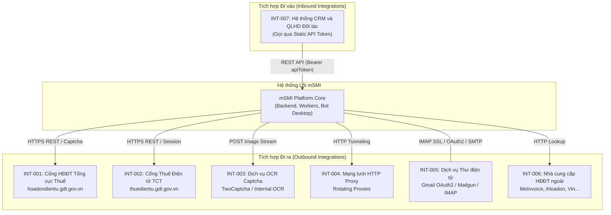

# DOC-10 — Đặc tả Tích hợp Hệ thống Ngoài (Integration Specification)

| Phiên bản | Ngày | Tác giả | Trạng thái |
|-----------|------|---------|------------|
| 1.1 | 2026-11-05 | Solution Architect | Baseline |

> **Tiêu chuẩn tham khảo:** Enterprise Integration Patterns (Gregor Hohpe); Adjunct of SAD (DOC-08).  
> **Căn cứ tài liệu gốc:** `documents/c4/01-system-context.md`, `documents/c4/02-container.md`.

---

## 1. Tổng quan Bản đồ Tích hợp

---

## 2. Danh mục Điểm Tích hợp Hệ thống Ngoài

| Mã INT | Hệ thống Tích hợp | Mục đích Nghiệp vụ | Hướng gọi | Giao thức | Tần suất | Bảo mật & Xác thực |
|:---:|---|---|:---:|:---:|:---:|---|
| **INT-001** | Cổng HĐĐT Tổng cục Thuế | Tra cứu, cào hóa đơn mua vào/bán ra, thông báo 04/SS | Outbound | HTTPS / REST | Liên tục (tick 5s) | Username/Password CQT + Captcha + JWT |
| **INT-002** | Cổng Thuế điện tử TCT | Cào tờ khai thuế, giấy nộp tiền, thông báo mTax | Outbound | HTTPS / REST | Định kỳ theo lịch | Tài khoản Thuế điện tử + Mã xác nhận |
| **INT-003** | Dịch vụ Giải Captcha | Tự động bóc tách ảnh captcha chữ/số của Cổng Thuế | Outbound | HTTPS / REST | Khi có phiên login | API Key / TwoCaptcha Secret |
| **INT-004** | Mạng lưới HTTP Proxy | Luân phiên địa chỉ IP cào dữ liệu chống chặn | Outbound | HTTP Tunnel | Theo từng request | Proxy Auth (IP Whitelist / User:Pass) |
| **INT-005** | Dịch vụ Email | Thu thập tệp đính kèm hóa đơn XML/PDF; gửi thông báo | Hai chiều | IMAP (993) / OAuth2 / SMTP | Định kỳ 15 phút | OAuth2 Token / App Password / SSL/TLS |
| **INT-006** | Nhà cung cấp HĐĐT ngoài | Tra cứu hóa đơn của MeInvoice, iHoadon, VinInvoice | Outbound | HTTPS / REST | Theo yêu cầu | API Secret / Public Form Lookup |
| **INT-007** | CRM & QLHD Đối tác | Cung cấp dữ liệu hóa đơn đã bóc tách sang PM kế toán | Inbound | HTTPS / REST | Theo nhu cầu đối tác | Static Header `apiToken` tĩnh theo đơn vị |

---

## 3. Đặc tả Chi tiết Từng Điểm Tích hợp

### 3.1. INT-001: Cổng Hóa đơn điện tử Tổng cục Thuế
- **Địa chỉ dịch vụ:** `https://hoadondientu.gdt.gov.vn`
- **Các luồng chính:**
  - `POST /proxy/api/v1/auth/login`: Gửi MST, Mật khẩu đã mã hóa và mã captcha để nhận JWT Token.
  - `GET /proxy/api/v1/invoices/purchase`: Truy vấn danh sách hóa đơn mua vào theo khoảng thời gian (`ge` - `le` không quá 31 ngày).
  - `GET /proxy/api/v1/invoices/sold`: Truy vấn danh sách hóa đơn bán ra.
  - `GET /proxy/api/v1/invoices/{id}/xml`: Tải chuỗi XML thông điệp hóa đơn gốc.
  - `GET /proxy/api/v1/invoices/tbss`: Kéo danh sách thông báo sai sót Mẫu 04/SS-HĐĐT.
- **Xử lý lỗi & Timeout:** Timeout mặc định 30 giây. Khi gặp mã lỗi HTTP 401 (Unauthorized), tự động kích hoạt luồng relogin; khi gặp HTTP 429/403, tự động chuyển proxy hoặc báo bot chuyển sang chế độ nghỉ ngắn (backoff).

### 3.2. INT-002: Cổng Thuế Điện tử (DVC / mTax)
- **Địa chỉ dịch vụ:** `https://thuedientu.gdt.gov.vn`
- **Cơ chế:** Quản lý thông qua microservice chuyên trách `mtax-api`. Thu thập danh sách tờ khai đã nộp, giấy nộp tiền ngân sách nhà nước, và các thông báo phản hồi của cơ quan thuế trực tiếp.
- **Cơ sở dữ liệu lưu trữ:** Lưu trữ biệt lập trên MongoDB database `mtax`.

### 3.3. INT-003: Dịch vụ Giải mã Captcha
- **Cơ chế:** Khi đăng nhập Cổng Thuế, bot tải file ảnh base64 captcha từ CQT, gửi sang microservice `captcha` nội bộ hoặc gọi sang cổng TwoCaptcha.
- **SLA:** Thời gian giải mã trung bình từ 1.2 - 2.5 giây; tỷ lệ chính xác yêu cầu đạt $\ge 92\%$. Nếu sai captcha (mã lỗi `06`), tự động lấy ảnh captcha mới và thử lại tối đa 3 lần.

### 3.4. INT-004: Mạng lưới HTTP Proxy & Chuẩn hóa Lỗi CQT (PFS / PRA)
- **Kiến trúc phân tầng xử lý (ADR-007):**
  - **Proxy Forwarder Service (PFS):** Điều phối luân chuyển proxy IP. Khi gặp lỗi upstream HTTP response từ CQT (500, 503) hoặc timeout thực tế (`ConnectTimeout = 20s`, `Forwarding.TimeoutSeconds = 120s`), PFS lập tức dừng failover, bảo toàn mã lỗi và gắn header `X-CQT-Timeout: true` hoặc `X-CQT-Error-Code: ALL_PROXIES_BANNED`.
  - **Proxy Request API (PRA):** Nguồn duy nhất dựng thông điệp hiển thị cho người dùng:
    * `401`: Phiên đăng nhập CQT đã hết hạn [401]. Hệ thống tự động kích hoạt luồng relogin.
    * `429`: Cơ quan thuế đang giới hạn số lượng yêu cầu [429].
    * `500` / `502` / `503`: CQT trả về lỗi [<Mã lỗi>]. Vui lòng thử lại sau.
    * `504` hoặc Timeout PFS: CQT không phản hồi trong thời gian chờ [504].
    * `ALL_PROXIES_BANNED`: Kết nối đến CQT hiện không khả dụng do đang bị giới hạn truy cập.
  - **Backend & Frontend:** Chuyển tiếp và hiển thị nguyên văn trường `message` của PRA, không tự ý ánh xạ lại.

### 3.5. INT-005: Dịch vụ Hộp thư Điện tử (Email Services)
- **Kênh Gmail:** Sử dụng Google API với OAuth2 scope `gmail.readonly` hoặc IMAP SSL port 993 với App Password (16 ký tự).
- **Kênh Mail Server Doanh nghiệp:** Kết nối giao thức IMAP/SSL tiêu chuẩn (port 993), tự động quét các folder `INBOX`.
- **Nguyên tắc xử lý:** Chỉ tải và giải nén các thư có file đính kèm định dạng `.xml` hoặc `.zip`.

### 3.6. INT-006: Nhà cung cấp HĐĐT Ngoài
- **Cơ chế:** Tra cứu hóa đơn của các nhà cung cấp phổ biến (MeInvoice, iHoadon, VinInvoice, VNPT, Viettel, M-Invoice...) qua form lookup hoặc public API.
- **Xử lý:** Đối chiếu số hóa đơn, mẫu số, ký hiệu và mã tra cứu để lấy bản thể hiện và XML gốc khi không cào được từ CQT.

### 3.7. INT-007: Tích hợp Hệ thống CRM và QLHD Ngoài
- **Cổng tiếp nhận:** `https://qlhd.minvoice.com.vn/erp/qlhd-api/`
- **Cơ chế xác thực:** Header `apiToken: <TOKEN_DON_VI>`.
- **Cung cấp API:** Lấy danh sách hóa đơn (`GET /invoices`), hóa đơn thay đổi (`GET /invoices/modified`), tải XML gốc (`GET /invoices/:id/download/xml`), tải bản in (`GET /invoices/:id/download/invoice.html`), lấy cảnh báo rủi ro (`GET /invoices/:id/warning`).

