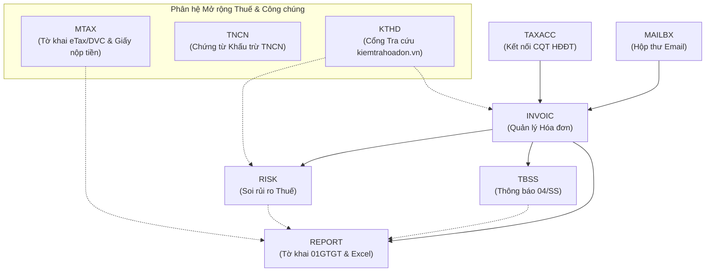

# DOC-03 — Yêu cầu Nghiệp vụ Tổng thể (Business Requirements Document - BRD)

| Phiên bản | Ngày | Tác giả | Trạng thái |
|-----------|------|---------|------------|
| 2.0 | 2026-11-08 | BA | Baseline Unified v2.0 |

> **Căn cứ tài liệu gốc & hiện trạng hệ thống:** Toàn bộ tài liệu nghiệp vụ gốc kết hợp hiện trạng mã nguồn thực tế (`mtax`, `tncn`, `kiemtrahd`).

---

## 1. Mục tiêu & Phạm vi Nghiệp vụ

Phạm vi chức năng của nền tảng mSMI bao gồm 10 nhóm nghiệp vụ chính:
1. **Thu thập dữ liệu HĐĐT**: Kết nối Cổng Thuế `hoadondientu.gdt.gov.vn` và Hộp thư Email (Gmail / IMAP Server) để tự động tải hóa đơn Mua vào, Bán ra.
2. **Kiểm soát rủi ro thuế**: Tra cứu trạng thái MST, rà soát Blacklist 1.500 DN rủi ro cao, phát hiện hóa đơn bị Hủy/Thay thế/Điều chỉnh, kiểm tra tính toàn vẹn chữ ký số và soi lệch tên pháp nhân.
3. **Quản lý hóa đơn Mua/Bán**: Bộ lọc đa tiêu chí, xem bản in PDF/HTML, tải XML đơn lẻ & hàng loạt ZIP, gán nhãn, gán kỳ kê khai thuế, hủy kê khai, đính kèm chứng từ và ghi chú nội bộ. Lưu trữ tệp trên hạ tầng MinIO S3.
4. **Thông báo sai sót (04/SS)**: Quản lý thông báo Mẫu 04/SS-HĐĐT từ CQT cả 2 chiều mua/bán; liên kết hai chiều với hóa đơn gốc.
5. **Danh mục tự động**: Danh mục Khách hàng/Nhà cung cấp, Hàng hóa/Dịch vụ, Danh mục Nhãn hóa đơn.
6. **Báo cáo & Tờ khai**: Tự động lập Tờ khai Thuế GTGT 01/GTGT, Bảng kê mua/bán theo thuế suất, xuất Excel động sang PMKT (MISA, FAST...).
7. **Quản lý Thuế Điện tử (mTax)**: Kết nối Cổng eTax và Cổng DVC để thu thập tờ khai thuế (Môn bài, GTGT, TNDN, BC26), giấy nộp tiền ngân sách nhà nước, thông báo thuế và danh mục tờ khai đăng ký.
8. **Chứng từ Khấu trừ Thuế TNCN (TNCN)**: Thu thập, lưu trữ và đối soát chứng từ khấu trừ thuế TNCN điện tử (Mẫu 03/TNCN) theo Nghị định 123 và Thông tư 78.
9. **Cổng Tra cứu & Kiểm tra Hóa đơn Công khai (kiemtrahd)**: Cổng tra cứu độc lập `kiemtrahoadon.vn` cho phép kiểm tra trạng thái CQT qua Captcha và thẩm định toàn diện file XML không cần đăng nhập.
10. **Quản trị & Tích hợp**: Phân quyền nhân viên theo MST, quản lý gói dịch vụ, cung cấp REST API cho hệ thống ngoài.

---

## 2. Danh mục 9 Phân hệ Nghiệp vụ (Module Index)

Toàn bộ nền tảng mSMI bao gồm **9 phân hệ nghiệp vụ** được chuẩn hóa theo chuẩn MiniPower:

| Module ID (`{MOD}`) | Tên Phân hệ Nghiệp vụ | Bounded Context / Trách nhiệm chính | Mức ưu tiên | Thư mục chi tiết |
|:---:|---|---|:---:|---|
| **`TAXACC`** | **Kết nối Cơ quan Thuế** | Quản lý tài khoản đăng nhập CQT, lịch trình tự động cào HĐĐT, giải mã Captcha, lịch sử đồng bộ. | **P0 (Must)** | `03-modules/taxacc/` |
| **`MAILBX`** | **Hộp thư Nhận Hóa đơn** | Kết nối hòm thư Gmail/IMAP, tự động quét thư, giải nén ZIP, bóc tách XML hóa đơn. | **P0 (Must)** | `03-modules/mailbx/` |
| **`INVOIC`** | **Quản lý Hóa đơn Mua/Bán** | Bộ lọc, xem in, tải XML/PDF đơn lẻ & hàng loạt, gán nhãn, gán kỳ kê khai, đính kèm chứng từ. | **P0 (Must)** | `03-modules/invoic/` |
| **`RISK`** | **Kiểm soát Rủi ro Thuế** | Kiểm tra trạng thái MST, Blacklist 1.500 DN rủi ro cao, cảnh báo HĐ bị Hủy/Sửa, chữ ký số. | **P0 (Must)** | `03-modules/risk/` |
| **`TBSS`** | **Thông báo Sai sót 04/SS** | Đồng bộ, xem bản thể hiện và liên kết thông báo sai sót 04/SS với hóa đơn gốc. | **P1 (Should)** | `03-modules/tbss/` |
| **`REPORT`** | **Báo cáo Thuế & PM Kế toán** | Bảng kê thuế suất, Tờ khai Thuế GTGT 01/GTGT, cấu hình xuất Excel động sang MISA, FAST. | **P0 (Must)** | `03-modules/report/` |
| **`MTAX`** | **Thuế Điện tử & Dịch vụ công** | Quản lý tài khoản eTax/DVC, đồng bộ tờ khai thuế, giấy nộp tiền NSNN, thông báo CQT. | **P0 (Must)** | `03-modules/mtax/` |
| **`TNCN`** | **Chứng từ Thuế TNCN** | Quản lý, đồng bộ và tra cứu chứng từ khấu trừ thuế TNCN điện tử Mẫu 03/TNCN. | **P1 (Should)** | `03-modules/tncn/` |
| **`KTHD`** | **Cổng Tra cứu Công khai** | Cổng độc lập tra cứu trạng thái hóa đơn CQT và thẩm định XML không cần tài khoản. | **P1 (Should)** | `03-modules/kiemtrahd/` |

---

## 3. Ma trận Phụ thuộc giữa 9 Phân hệ Nghiệp vụ

