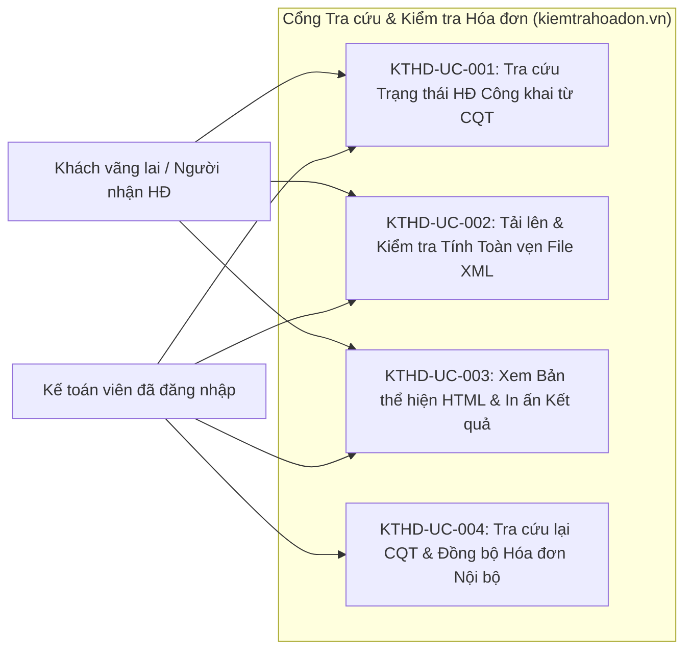

# DOC-05 — Đặc tả Ca Sử dụng Phân hệ Cổng Tra cứu & Kiểm tra Hóa đơn (KIEMTRAHD)

| Phiên bản | Ngày | Tác giả | Trạng thái |
|-----------|------|---------|------------|
| 2.0 | 2026-11-08 | BA | Baseline Unified v2.0 |

> **Phân hệ:** `KIEMTRAHD` — Cổng Kiểm tra & Tra cứu Hóa đơn Điện tử Công khai  
> **Căn cứ mã nguồn thực tế:** `kiemtrahoadon/`, `documents/c4/03-components/kiemtra-hd-portal.md`.

---

## 1. Sơ đồ Tổng quan Ca Sử dụng (Use Case Diagram)

---

## 2. Danh mục Ca Sử dụng (Use Case Register)

| Mã UC | Tên Ca Sử dụng | Tác nhân chính | Mức ưu tiên | Mô tả tóm tắt |
|:---:|---|---|:---:|---|
| **KTHD-UC-001** | Tra cứu Trạng thái HĐ Công khai từ CQT | Khách vãng lai / Kế toán | Must | Nhập MST người bán, loại HĐ, ký hiệu, số HĐ, số tiền/ngày lập và mã Captcha để kiểm tra trạng thái trên Cổng Thuế. |
| **KTHD-UC-002** | Tải lên & Thẩm định Tính Toàn vẹn File XML | Khách vãng lai / Kế toán | Must | Tải lên tệp XML hóa đơn điện tử; hệ thống kiểm tra chữ ký số, tính toàn vẹn XML, mã CQT và thông tin đơn vị bán. |
| **KTHD-UC-003** | Xem Bản thể hiện HTML & In ấn Kết quả | Khách vãng lai / Kế toán | Must | Xem song song bản in hóa đơn đồ họa và phiếu kết quả kiểm tra; hỗ trợ in hóa đơn trực tiếp ra giấy hoặc PDF. |
| **KTHD-UC-004** | Tra cứu lại CQT & Đồng bộ Hóa đơn Nội bộ | Kế toán viên có tài khoản | Should | Kiểm tra lại trạng thái CQT từ trang chi tiết hóa đơn nội bộ và tự động cập nhật trạng thái mới nhất vào CSDL. |

---

## 3. Đặc tả Chi tiết Từng Ca Sử dụng

### 3.1. KTHD-UC-001: Tra cứu Trạng thái Hóa đơn Công khai từ Cơ quan Thuế
* **Tác nhân:** Khách vãng lai, Người mua hàng nhận hóa đơn điện tử, Kế toán doanh nghiệp.
* **Tiền điều kiện:** Người dùng có thông tin về hóa đơn cần tra cứu (tối thiểu gồm MST người bán, ký hiệu, số hóa đơn).
* **Luồng sự kiện chính (Main Flow):**
  1. Người dùng truy cập Cổng tra cứu công khai `kiemtrahoadon.vn` (màn hình chính `#/kiem-tra-hoa-don`).
  2. Hệ thống tải và hiển thị mã bảo vệ Captcha (đồ họa SVG lấy trực tiếp từ Cổng Tổng cục Thuế).
  3. Người dùng nhập các thông tin tra cứu:
     - Mã số thuế người bán (`mst`).
     - Loại hóa đơn (`khmshdon`): Chọn trong danh sách (Mẫu 1: GTGT, Mẫu 2: Bán hàng, Mẫu 6: Vé/thẻ...).
     - Ký hiệu hóa đơn (`khhdon`): Ví dụ `C24TAA`.
     - Số hóa đơn (`shdon`).
     - Nhập `Tổng tiền thanh toán` (nếu loại HĐ khác 6) hoặc `Ngày lập hóa đơn` (nếu loại HĐ là 6) theo quy tắc `KTHD-BR-002`.
     - Nhập chuỗi ký tự hiển thị trên ảnh Captcha.
  4. Người dùng bấm **"Tìm kiếm"**.
  5. Hệ thống gọi API tra cứu công khai (`GET /query/guest-invoices`), đối soát dữ liệu với Cơ quan Thuế.
  6. Hệ thống hiển thị kết quả bao gồm:
     - Trạng thái hóa đơn tại Cơ quan Thuế (Ví dụ: Hóa đơn hợp pháp, Đã hủy, Bị điều chỉnh/thay thế).
     - Trạng thái xử lý của Cơ quan Thuế (Đã cấp mã, Không cấp mã, CQT từ chối tiếp nhận).
     - Danh sách thông báo sai sót (TBSS Mẫu 04/SS) liên quan đến hóa đơn (nếu có).
     - Danh sách các hóa đơn liên quan (Hóa đơn gốc, Hóa đơn thay thế, Hóa đơn điều chỉnh).
  7. Hệ thống tự động làm mới mã Captcha để sẵn sàng cho lần tra cứu tiếp theo.
* **Luồng ngoại lệ (Exceptional Flow):**
  - *Nhập sai Captcha:* Hệ thống hiển thị thông báo "Mã xác thực không chính xác", tự động đổi ảnh Captcha mới, giữ nguyên các thông tin form đã nhập để người dùng nhập lại mã.
  - *Không tìm thấy hóa đơn:* Hệ thống thông báo "Không tìm thấy hóa đơn khớp với thông tin đã nhập trên Cổng Thuế".

---

### 3.2. KTHD-UC-002: Tải lên & Thẩm định Tính Toàn vẹn File XML Hóa đơn
* **Tác nhân:** Khách vãng lai / Kế toán viên.
* **Tiền điều kiện:** Người dùng có tệp tin định dạng `.xml` của hóa đơn điện tử.
* **Luồng sự kiện chính (Main Flow):**
  1. Tại màn hình kiểm tra hóa đơn, người dùng chọn khu vực **"Kiểm tra hóa đơn bằng tệp XML"**.
  2. Người dùng kéo-thả hoặc bấm chọn tệp `.xml` từ máy tính.
  3. Hệ thống gửi tệp lên API phân tích (`POST /upload_xml_data`).
  4. Hệ thống tiến hành bóc tách cú pháp và kiểm định theo `KTHD-BR-003`:
     - Kiểm tra lược đồ XSD và cấu trúc file (`xmlnven`).
     - Trích xuất chữ ký số, thẩm tra tính toàn vẹn và chứng thư số (`nbcks`, `Issuer`, `SigningBy`, thời hạn hiệu lực).
     - Kiểm tra tính hợp lệ của mã Cơ quan Thuế cấp (`cqtcma`).
     - Đối chiếu MST và tên đơn vị bán với cơ sở dữ liệu quốc gia về người nộp thuế.
  5. Hệ thống hiển thị thông báo phân tích hoàn tất và tự động mở màn hình đối soát chi tiết `KTHD-UC-003`.
* **Luồng ngoại lệ:**
  - *Tệp tải lên không phải XML hoặc cấu trúc bị lỗi nặng:* Hệ thống báo lỗi "Tệp không đúng định dạng XML hóa đơn điện tử chuẩn theo quy định của Tổng cục Thuế".

---

### 3.3. KTHD-UC-003: Xem Bản thể hiện HTML & In ấn Hóa đơn / Kết quả Kiểm tra
* **Tác nhân:** Khách vãng lai / Kế toán viên.
* **Tiền điều kiện:** Đã hoàn tất bước kiểm tra XML (`KTHD-UC-002`) hoặc tra cứu hóa đơn thành công.
* **Luồng sự kiện chính (Main Flow):**
  1. Hệ thống mở cửa sổ đối soát dạng phóng to (Split view dialog):
     - **Cột trái:** Khung xem bản thể hiện HTML trực quan của hóa đơn (`/upload_xml_data/:id/html`), hiển thị đầy đủ thông tin bên bán, bên mua, danh mục hàng hóa dịch vụ, thuế suất, tổng tiền và tiêu bản mẫu hóa đơn.
     - **Cột phải:** Bảng tổng hợp kết quả thẩm định pháp lý (`#/xml-info?id=:id`):
       - Trạng thái chữ ký số (Hợp lệ / Không hợp lệ kèm dấu tích xanh hoặc cảnh báo đỏ).
       - Tên đơn vị ký và tổ chức cấp chứng thư số CA.
       - Trạng thái mã Cơ quan Thuế cấp.
       - Cảnh báo rủi ro về người nộp thuế (nếu có).
  2. Người dùng có thể bấm nút **"In hóa đơn"**: Hệ thống kích hoạt hộp thoại in của trình duyệt để in bản thể hiện hóa đơn.
  3. Người dùng có thể bấm nút **"In kết quả kiểm tra"**: Hệ thống xuất bản in bảng thẩm định pháp lý phục vụ lưu trữ nội bộ.
  4. Hệ thống tuân thủ phân quyền khách vãng lai `KTHD-BR-004` (ẩn các tác vụ tải XML, gắn nhãn, thêm ghi chú).

---

### 3.4. KTHD-UC-004: Tra cứu lại CQT & Đồng bộ Hóa đơn Nội bộ
* **Tác nhân:** Kế toán viên doanh nghiệp đã đăng nhập hệ thống mSMI.
* **Tiền điều kiện:** Hóa đơn đã tồn tại trong danh sách hóa đơn đầu vào của doanh nghiệp (`#/invoice-info?id=...`).
* **Luồng sự kiện chính (Main Flow):**
  1. Người dùng mở xem chi tiết một hóa đơn trong kho lưu trữ mSMI.
  2. Người dùng bấm nút **"Tra cứu CQT"**.
  3. Hệ thống mở hộp thoại tra cứu nhanh (`InvoiceStatus`), tự động điền sẵn các tham số của hóa đơn và yêu cầu nhập mã Captcha CQT.
  4. Người dùng nhập Captcha và nhấn xác nhận.
  5. Hệ thống gọi `GET /query/guest-invoices`.
  6. Sau khi nhận kết quả từ CQT, hệ thống so sánh trạng thái trả về với trạng thái hiện thời của hóa đơn trong CSDL Mongo:
     - Nếu trạng thái khác biệt (ví dụ: hóa đơn trước đây ở trạng thái "Gốc", nay CQT ghi nhận "Bị thay thế" hoặc "Đã hủy"), hệ thống tự động gọi API `PATCH /invoices/:id/tthai` để cập nhật trạng thái mới nhất.
     - Cập nhật lại giao diện và thông báo cho kế toán biết trạng thái đã được đồng bộ chuẩn xác.

