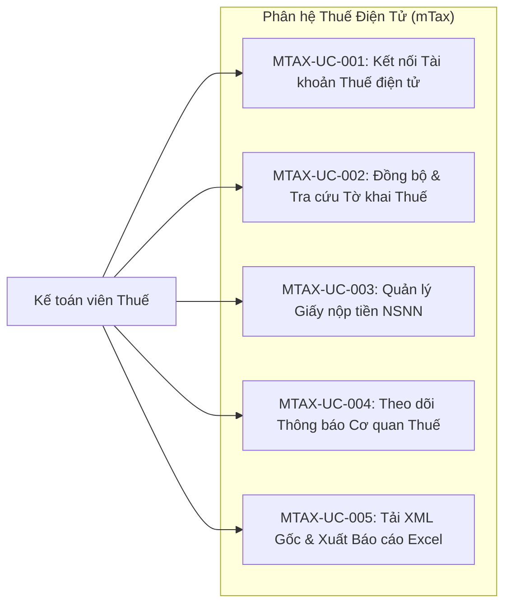

# DOC-05 — Đặc tả Ca Sử dụng Phân hệ Thuế Điện tử (MTAX)

| Phiên bản | Ngày | Tác giả | Trạng thái |
|-----------|------|---------|------------|
| 2.0 | 2026-11-08 | BA | Baseline Unified v2.0 |

> **Phân hệ:** `MTAX` — Quản lý Thuế Điện tử & Dịch vụ công Tổng cục Thuế  
> **Căn cứ mã nguồn thực tế:** `documents/features/mtax/`, `frontend/src/app/to-khai-thue/`, `mtax-fe/`, `mtax-api/`.

---

## 1. Sơ đồ Tổng quan Ca Sử dụng (Use Case Diagram)

---

## 2. Danh mục Ca Sử dụng (Use Case Register)

| Mã UC | Tên Ca Sử dụng | Tác nhân chính | Mức ưu tiên | Mô tả tóm tắt |
|:---:|---|---|:---:|---|
| **MTAX-UC-001** | Kết nối Tài khoản Thuế Điện tử | Kế toán viên | Must | Cấu hình MST, tài khoản và mật khẩu eTax / DVC; kiểm tra tính hợp lệ kết nối. |
| **MTAX-UC-002** | Đồng bộ & Tra cứu Tờ khai Thuế | Kế toán viên | Must | Tự động hoặc thủ công kéo toàn bộ tờ khai từ Cổng Thuế về hệ thống; lọc theo kỳ và loại tờ khai. |
| **MTAX-UC-003** | Quản lý Giấy nộp tiền NSNN | Kế toán viên | Must | Tra cứu danh sách các lần nộp thuế, đối soát số tiền, kho bạc thụ hưởng và tải chứng từ nộp thuế. |
| **MTAX-UC-004** | Theo dõi Thông báo Cơ quan Thuế | Kế toán viên | Must | Tra cứu thông báo bước 1 (tiếp nhận) và bước 2 (chấp nhận/từ chối); xem lý do nếu bị CQT từ chối. |
| **MTAX-UC-005** | Tải XML Gốc & Xuất Báo cáo Excel | Kế toán viên | Must | Tải tệp XML tờ khai nguyên bản (đơn lẻ hoặc đóng gói ZIP hàng loạt) để mở bằng iTaxViewer và xuất báo cáo danh sách tờ khai ra Excel. |

---

## 3. Đặc tả Chi tiết Từng Ca Sử dụng

### 3.1. MTAX-UC-001: Kết nối Tài khoản Thuế Điện tử
* **Tác nhân:** Kế toán viên Thuế / Quản trị viên.
* **Tiền điều kiện:** Người dùng có thông tin tài khoản đăng nhập Cổng Thuế điện tử (`thuedientu.gdt.gov.vn`) hoặc Cổng Dịch vụ công Quốc gia (`dichvucong.gov.vn`).
* **Luồng sự kiện chính (Main Flow):**
  1. Kế toán truy cập màn hình Cấu hình Tài khoản Thuế điện tử trong phân hệ mTax.
  2. Người dùng chọn nguồn kết nối: `ETAX` (Thuế điện tử) hoặc `DVC` (Dịch vụ công).
  3. Nhập Mã số thuế doanh nghiệp (`taxCode`), Tên đăng nhập (định dạng `{MST}-QL`) và Mật khẩu Cổng Thuế.
  4. Bấm nút **"Kiểm tra kết nối & Lưu"**.
  5. Hệ thống gửi yêu cầu xác thực sang dịch vụ kết nối Cổng Thuế để kiểm tra thông tin đăng nhập.
  6. Khi kết nối hợp lệ, hệ thống lưu cấu hình tài khoản ở trạng thái mã hóa an toàn, hiển thị trạng thái màu xanh "Đang hoạt động" và kích hoạt scheduler quét dữ liệu định kỳ.
* **Luồng ngoại lệ (Exceptional Flow):**
  - *Sai thông tin đăng nhập:* Hệ thống hiển thị thông báo lỗi chi tiết từ Cổng Thuế (sai mật khẩu, tài khoản bị tạm khóa), giữ nguyên form để người dùng chỉnh sửa.

---

### 3.2. MTAX-UC-002: Đồng bộ & Tra cứu Tờ khai Thuế
* **Tác nhân:** Kế toán viên Thuế.
* **Tiền điều kiện:** Doanh nghiệp đã kết nối thành công tài khoản Thuế điện tử (`MTAX-UC-001`).
* **Luồng sự kiện chính (Main Flow):**
  1. Kế toán truy cập màn hình **Quản lý Tờ khai Thuế** trên phân hệ mTax.
  2. Người dùng chọn phạm vi lọc:
     - Nguồn cổng: `DVC` hoặc `ETAX`.
     - Khoảng thời gian nộp hoặc Kỳ tính thuế (Tháng/Quý/Năm).
     - Loại tờ khai (Môn bài, GTGT, TNDN, Báo cáo tình hình sử dụng hóa đơn).
     - Trạng thái CQT (Tất cả, Đã tiếp nhận, Đã chấp nhận, Bị từ chối).
  3. Người dùng bấm nút **"Đồng bộ ngay"** hoặc xem danh sách hệ thống đã quét ngầm tự động.
  4. Hệ thống gọi sang cụm API `mtax-api` (`POST /api/v2/declaration/crawl`) điều phối cào dữ liệu từ Cổng Thuế.
  5. Hệ thống trả về bảng danh sách tờ khai phân trang, hiển thị rõ: Tên tờ khai, Mẫu tờ khai, Kỳ tính thuế, Lần nộp (Chính thức / Bổ sung lần N), Ngày nộp, Mã giao dịch CQT, và Trạng thái xử lý.
* **Luồng thay thế (Alternative Flow):**
  - *Tờ khai bị CQT từ chối:* Hệ thống gắn biểu tượng cảnh báo màu đỏ; kế toán nhấp vào để xem ngay thông báo từ chối tương ứng (`MTAX-UC-004`) và lý do cụ thể.

---

### 3.3. MTAX-UC-003: Quản lý Giấy nộp tiền NSNN
* **Tác nhân:** Kế toán viên / Kế toán trưởng.
* **Luồng sự kiện chính (Main Flow):**
  1. Người dùng vào tab **"Giấy nộp tiền"**.
  2. Hệ thống hiển thị toàn bộ lịch sử các giao dịch nộp thuế điện tử thành công vào Kho bạc Nhà nước.
  3. Kế toán có thể lọc theo: Năm nộp, Số chứng từ ngân hàng, Mã tiểu mục nộp thuế (ví dụ lọc riêng tiền thuế GTGT đã nộp).
  4. Bấm vào từng giấy nộp tiền để xem chi tiết thông tin: Ngân hàng trích nợ, Tài khoản Kho bạc Nhà nước thụ hưởng, Mã cơ quan thuế quản lý thu, Số tiền ghi bằng số và bằng chữ.
  5. Bấm nút **"Tải Giấy nộp tiền"** để lưu file XML/chứng từ nộp thuế phục vụ lưu trữ, đối soát quyết toán thuế.

---

### 3.4. MTAX-UC-004: Theo dõi Thông báo Cơ quan Thuế
* **Tác nhân:** Kế toán viên Thuế.
* **Tiền điều kiện:** Tờ khai thuế hoặc giấy nộp tiền đã gửi lên Cổng Thuế và có mã giao dịch CQT (`transactionCode`).
* **Luồng sự kiện chính (Main Flow):**
  1. Kế toán xem bảng danh sách Tờ khai thuế, tại cột Thông báo hoặc Trạng thái, bấm nút **"Xem thông báo"**.
  2. Hệ thống gọi API `NoticeService.List(transactionCode)` lấy danh sách toàn bộ văn bản thông báo do CQT phản hồi tương ứng với mã giao dịch.
  3. Hệ thống hiển thị cửa sổ danh sách Thông báo, phân loại rõ ràng:
     - *Thông báo bước 1 (Tiếp nhận hồ sơ khai thuế):* Ghi nhận ngày giờ tiếp nhận hồ sơ hợp lệ.
     - *Thông báo bước 2 (Chấp nhận hoặc Không chấp nhận hồ sơ):* Kết luận của CQT về tính hợp lệ của tờ khai.
  4. Người dùng bấm nút **"Tải XML Thông báo"** (`NoticeService.DownloadXml`) để tải tệp XML thông báo gốc có chữ ký số của CQT về máy tính.
* **Luồng thay thế (Alternative Flow):**
  - *Hồ sơ bị từ chối:* Cửa sổ thông báo hiển thị nổi bật lý do không chấp nhận từ CQT (chữ ký số không hợp lệ, sai cấu trúc XML...) để kế toán kịp thời xử lý nộp lại.

---

### 3.5. MTAX-UC-005: Tải XML Gốc & Xuất Báo cáo Excel
* **Tác nhân:** Kế toán viên Thuế.
* **Tiền điều kiện:** Danh sách tờ khai đã được đồng bộ về hệ thống.
* **Luồng sự kiện chính (Main Flow):**
  1. Kế toán truy cập màn hình Danh sách Tờ khai thuế.
  2. Tại từng dòng tờ khai, kế toán bấm nút **"Tải XML"** (`downloadXml`) để lưu file XML nguyên vẹn đã ký số về máy và mở bằng phần mềm iTaxViewer.
  3. Hoặc chọn nhiều tờ khai và bấm **"Tải danh sách XML"** (`downloadMultipleXml`) để hệ thống nén thành tệp ZIP tải về một lần.
  4. Người dùng thiết lập bộ lọc theo kỳ/năm và bấm nút **"Xuất Excel"** (`downloadExcel`) để kết xuất báo cáo danh sách tờ khai phục vụ báo cáo nội bộ.
