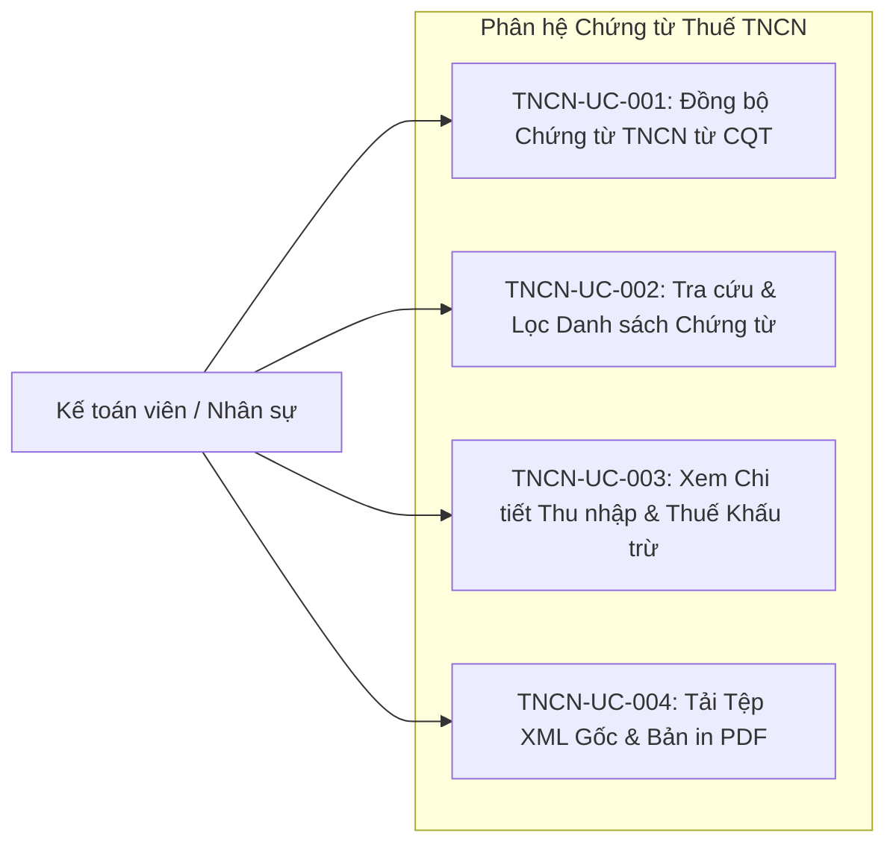

# DOC-05 — Đặc tả Ca Sử dụng Phân hệ Chứng từ Thuế TNCN (TNCN)

| Phiên bản | Ngày | Tác giả | Trạng thái |
|-----------|------|---------|------------|
| 2.0 | 2026-11-08 | BA | Baseline Unified v2.0 |

> **Phân hệ:** `TNCN` — Quản lý Chứng từ Khấu trừ Thuế Thu nhập Cá nhân Điện tử  
> **Căn cứ mã nguồn thực tế:** `backend/service/chung-tu-tncn/`, `backend/models/chung_tu_tncn.js`.

---

## 1. Sơ đồ Tổng quan Ca Sử dụng (Use Case Diagram)

---

## 2. Danh mục Ca Sử dụng (Use Case Register)

| Mã UC | Tên Ca Sử dụng | Tác nhân chính | Mức ưu tiên | Mô tả tóm tắt |
|:---:|---|---|:---:|---|
| **TNCN-UC-001** | Đồng bộ Chứng từ TNCN từ CQT | Kế toán viên | Must | Kích hoạt cào chứng từ tự động theo lịch hoặc bấm cào thủ công theo khoảng ngày (chunk $\le$ 7 ngày). |
| **TNCN-UC-002** | Tra cứu & Lọc Danh sách Chứng từ | Kế toán / HR | Must | Tìm kiếm chứng từ theo MST cá nhân, số CCCD, họ tên người lao động, hoặc khoảng thời gian chi trả. |
| **TNCN-UC-003** | Xem Chi tiết Thu nhập & Thuế Khấu trừ | Kế toán / HR | Must | Xem thông tin chi tiết từng chỉ tiêu: Thu nhập chịu thuế, số thuế khấu trừ, số tiền thực nhận. |
| **TNCN-UC-004** | Tải Tệp XML Gốc & Bản in PDF | Kế toán / Cá nhân | Must | Kết xuất bản in PDF có mã vạch/chữ ký số và tải tệp XML gốc để phục vụ cá nhân đi quyết toán thuế TNCN. |

---

## 3. Đặc tả Chi tiết Từng Ca Sử dụng

### 3.1. TNCN-UC-001: Đồng bộ Chứng từ Khấu trừ Thuế TNCN
* **Tác nhân:** Kế toán viên.
* **Tiền điều kiện:** Tài khoản CQT của doanh nghiệp đang ở trạng thái hoạt động hợp lệ.
* **Luồng sự kiện chính:**
  1. Người dùng mở màn hình **Chứng từ thuế TNCN**, bấm nút **"Đồng bộ ngay"**.
  2. Hệ thống hiển thị hộp thoại `DialogSyncChungTuNow`:
     - Cho phép chọn khoảng ngày phát sinh chứng từ (từ ngày đến ngày, tối đa 31 ngày; chia thành các chunk $\le$ 7 ngày để tránh nghẽn).
  3. Kế toán xác nhận lệnh đồng bộ.
  4. Hệ thống đẩy job cào vào queue `crawl-chung-tu-tncn-auto` qua Proxy Forwarder hoặc Bot Desktop gọi endpoint `GET /api/pitw` của Cổng Thuế.
  5. Khi có phản hồi, consumer `chungTuTncnHeader` bóc tách dữ liệu và lưu vào CSDL `chungtutncns`.
  6. Màn hình tự động cập nhật danh sách chứng từ mới thu thập được kèm số lượng phát hiện.

---

### 3.2. TNCN-UC-002: Tra cứu & Lọc Danh sách Chứng từ
* **Tác nhân:** Kế toán viên / Cán bộ nhân sự.
* **Luồng sự kiện chính:**
  1. Kế toán truy cập màn hình danh sách chứng từ.
  2. Người dùng nhập từ khóa tìm kiếm:
     - Nhập Mã số thuế cá nhân hoặc Số CCCD của người lao động.
     - Lọc theo năm quyết toán thuế (ví dụ: *Năm 2026*).
     - Lọc theo Ký hiệu chứng từ hoặc Số chứng từ.
  3. Hệ thống trả về bảng danh sách phân trang:
     - Số chứng từ, Ký hiệu, Ngày lập chứng từ.
     - Họ tên người nộp thuế, MST/CCCD.
     - Tổng thu nhập chịu thuế, Số thuế đã khấu trừ.
  4. Người dùng có thể click vào bất kỳ dòng nào để xem chi tiết hoặc tải bản in (`TNCN-UC-003`, `004`).

---

### 3.3. TNCN-UC-003: Xem Chi tiết Thu nhập & Thuế Khấu trừ
* **Tác nhân:** Kế toán viên / Cán bộ nhân sự.
* **Tiền điều kiện:** Đã tìm thấy chứng từ cần kiểm tra trong danh sách (`TNCN-UC-002`).
* **Luồng sự kiện chính:**
  1. Kế toán nhấp chọn một dòng chứng từ trong danh sách.
  2. Hệ thống hiển thị hộp thoại chi tiết chứng từ khấu trừ thuế TNCN Mẫu 03/TNCN.
  3. Hệ thống hiển thị đầy đủ các khối thông tin:
     - Thông tin đơn vị chi trả thu nhập (Tên công ty, MST, Địa chỉ).
     - Thông tin người nhận thu nhập (Họ và tên, MST cá nhân / Số CCCD, Quốc tịch, Cá nhân cư trú / không cư trú).
     - Thông tin chi tiết thu nhập: Khoản thu nhập, Thời điểm chi trả, Tổng thu nhập chịu thuế, Tổng thu nhập tính thuế, Số thuế TNCN đã khấu trừ, Số tiền còn được nhận.
  4. Hệ thống hiển thị trạng thái chữ ký số điện tử của bên chi trả thu nhập trên chứng từ.

---

### 3.4. TNCN-UC-004: Tải Tệp XML Gốc & Bản in PDF
* **Tác nhân:** Kế toán viên / Người nộp thuế cá nhân.
* **Tiền điều kiện:** Chứng từ đã có tệp XML gốc lưu trữ trên hệ thống lưu trữ MinIO S3 (`xmlKey`).
* **Luồng sự kiện chính:**
  1. Tại màn hình danh sách hoặc chi tiết chứng từ, người dùng bấm nút **"Tải XML"**.
  2. Hệ thống trích xuất tệp XML nguyên bản đã ký số từ MinIO S3 và tải về máy tính người dùng.
  3. Người dùng bấm nút **"Xem / In PDF"**.
  4. Hệ thống render bản thể hiện chứng từ chuẩn mẫu 03/TNCN của Bộ Tài chính kèm mã vạch và thông tin chứng thư số.
  5. Người dùng có thể in trực tiếp ra giấy hoặc lưu thành tệp PDF gửi cho người lao động phục vụ tự quyết toán thuế TNCN.

