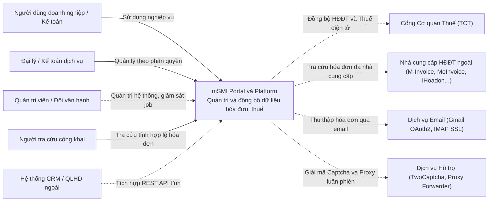
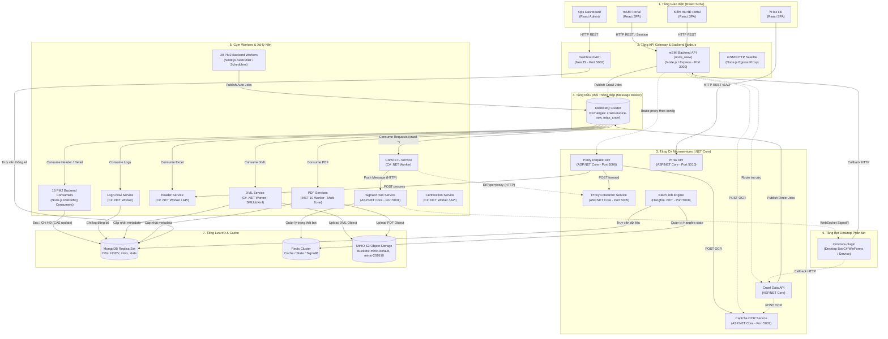
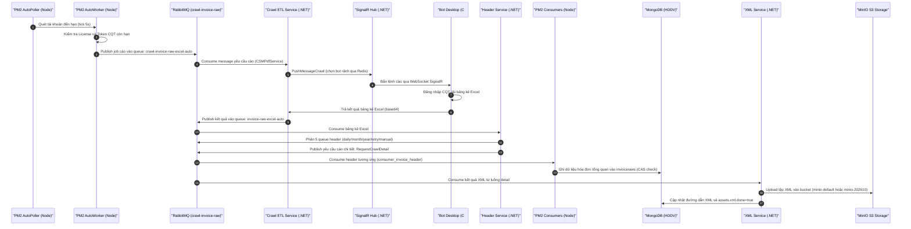
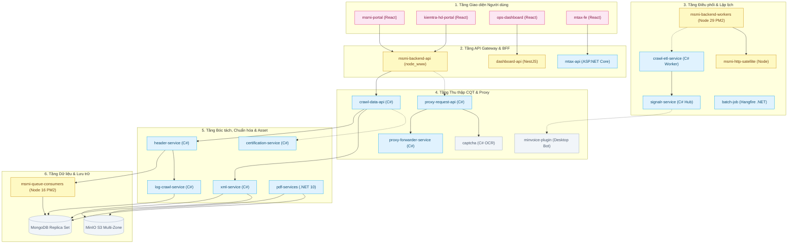

# DOC-08 — Tài liệu Kiến trúc Giải pháp Hệ thống mSMI (SAD)

| Phiên bản | Ngày | Tác giả | Trạng thái |
|:---:|:---:|:---:|:---:|
| 2.0 | 2026-11-08 | Solution Architect | Master Baseline Unified v2.0 |

> **Chế độ hồ sơ:** `maintain` (Hệ thống hiện hữu — Chuẩn hóa tài liệu Kiến trúc Kỹ thuật thực tế)  
> **Tiêu chuẩn tham khảo:** **SEI** — *Documenting Software Architectures: Views and Beyond*; **Kruchten 4+1 View Model**; **C4 Model** (Context, Container, Component, Code).  
> **Căn cứ đối chiếu mã nguồn:** Toàn bộ mã nguồn thực tế tại `backend/`, `frontend/`, `dashboard/`, `crawl-data-api/`, `proxy-request-api/`, `proxy-forwarder-service/`, `signalr-service/`, `header-service/`, `xml-service/`, `pdf-services/`, `crawl-etl-service/`, `mtax-api/`, `batch-job/`, `minvoice-plugin/` và toàn bộ tài liệu C4 tại `documents/c4/` (C1, C2, C3, C4).

---

## 1. Giới thiệu & Tổng quan

### 1.1. Mục đích
Tài liệu này chuẩn hóa toàn diện kiến trúc kỹ thuật của hệ thống **mSMI (Minvoice SME Invoice)** theo chuẩn tài liệu **MiniPower (`DOC-08`)**. Tài liệu phản ánh chính xác 100% cấu trúc giải pháp đang triển khai trong mã nguồn thực tế, các luồng runtime cross-container, cơ chế phân tán message broker RabbitMQ, và hạ tầng lưu trữ đối tượng MinIO S3.

### 1.2. Phạm vi Kiến trúc
- **In-Scope:** 
  - Toàn bộ các ứng dụng giao diện web (React SPAs: `msmi-portal`, `mtax-fe`, `kiemtra-hd-portal`, `ops-dashboard`).
  - Hệ thống Core Backend & BFF Node.js (Express, điều phối cụm 47 tiến trình PM2).
  - Cụm Microservices hiệu năng cao viết bằng C# (.NET Core 6/8/9/10: crawl, ETL, parse Excel, xử lý XML, PDF, proxy pool, captcha).
  - Mạng lưới Bot Desktop phân tán giao tiếp qua WebSocket SignalR Hub (`minvoice-plugin`).
  - Hệ thống hạ tầng truyền thông và dữ liệu: RabbitMQ Cluster, MongoDB Replica Set, Redis Cache và MinIO S3 Object Storage.
- **Out-of-Scope:**
  - Hệ thống máy chủ nội bộ của Cơ quan Thuế (Cổng Thuế điện tử TCT).
  - Hạ tầng bên thứ ba độc lập (Dịch vụ giải mã Captcha 2Captcha, hạ tầng CRM khách hàng).

### 1.3. Tài liệu Tham chiếu
- [`DOC-09 ADR`](./DOC-09-adr/README.md): Sổ bộ 7 quyết định kiến trúc kỹ thuật chuẩn hóa (`ADR-001` đến `ADR-007`).
- [`DOC-10 Integration`](./DOC-10-integration-specification.md): Đặc tả tích hợp 7 hệ thống bên ngoài.
- [`DOC-13 NFR`](./DOC-13-nfr.md): Yêu cầu phi chức năng (Throughput, Concurrency, Latency, TTL, Timeout).
- [`DOC-17 Deployment`](./DOC-17-deployment-guide.md): Hướng dẫn triển khai cụm 47 PM2 processes và hạ tầng.
- [`c4-to-minipower-mapping.md`](../05-traceability/c4-to-minipower-mapping.md): Bảng ánh xạ đối soát 1-1 từ C4 sang MiniPower.
- [`doc-registry.md`](../05-traceability/doc-registry.md) & [`trace-matrix.md`](../05-traceability/trace-matrix.md): Danh mục hồ sơ và ma trận truy vết.

### 1.4. Tổng quan Kiến trúc (Executive Architecture Summary)
Hệ thống **mSMI** được thiết kế theo mô hình **Kiến trúc Lai Hướng Sự kiện (Hybrid Event-Driven Microservices Architecture)**:
1. **Frontend Tier**: Đa cổng giao diện React SPA phục vụ Kế toán doanh nghiệp (`mSMI Portal`), Khai báo thuế điện tử (`mTax FE`), và Tra cứu công khai (`Kiểm tra HĐ Portal`).
2. **Core Backend & BFF (Node.js)**: Ứng dụng Express quản lý phiên, xác thực người dùng, nghiệp vụ kế toán, tờ khai và điều phối cụm **47 tiến trình PM2** chạy nền (1 Web Server, 29 Background Workers/Pollers, 16 RabbitMQ Consumers, 1 Satellite proxy).
3. **High-Performance Worker Mesh (.NET Core / .NET 10)**: Xử lý các tác vụ tính toán chuyên sâu và thông lượng lớn: bóc tách danh sách Excel (`header-service`), phân tích cú pháp XML và verify chữ ký số (`xml-service`), xử lý phân vùng file PDF (`pdf-services`), và quản lý tác vụ định kỳ phân tán (`batch-job` với Hangfire).
4. **Data Acquisition Pipeline (Thu thập Dữ liệu Đa tầng)**: Giải quyết triệt để bài toán rate limit và chặn IP từ Cổng Thuế bằng cơ chế kết hợp: **SignalR Hub kết hợp Bot Desktop** và **Proxy Forwarder Service xoay vòng IP**.
5. **Event-driven Backbone (RabbitMQ)**: Điều phối dữ liệu bất đồng bộ qua 2 Exchange chính (`crawl-invoice-raw`, `mtax_crawl`) với cơ chế phân tách rõ rệt giữa hàng đợi yêu cầu (**REQUEST**) và hàng đợi phản hồi (**RESPONSE**), cùng 5 hàng đợi Header độc lập chống đói tài nguyên.
6. **Object Storage Tier (MinIO S3)**: Tách rời hoàn toàn file nhị phân (XML, PDF) ra khỏi MongoDB theo phân vùng thời gian (`minio-default` cho dữ liệu trước tháng 10/2026 và `minio-202610` từ tháng 10/2026 trở đi).

---

## 2. Mục tiêu & Ràng buộc Kiến trúc (Architecture Goals & Constraints)

| Mã ID | Mục tiêu / Ràng buộc | Mô tả chi tiết | Trace NFR / ADR |
|:---:|---|---|:---:|
| **AG-001** | **Khả năng Chịu tải Thu thập Lớn** | Hệ thống phải có khả năng cào và bóc tách hàng trăm nghìn hóa đơn mỗi ngày mà không làm nghẽn API phục vụ người dùng. | `NFR-PERF-001`<br>`ADR-001` |
| **AG-002** | **Chống Chặn IP và Vượt Rate Limit CQT** | Phải có cơ chế luân phiên proxy và phân tán bot cào để đối phó với chính sách giới hạn tần suất truy vấn từ Cổng Thuế quốc gia. | `NFR-RES-001`<br>`ADR-002` |
| **AG-003** | **Bảo toàn Hiệu năng CSDL (Storage Decoupling)**| Không lưu trực tiếp tệp nhị phân XML/PDF dung lượng lớn vào MongoDB Document; bắt buộc lưu trữ qua MinIO S3 Object Storage. | `NFR-STOR-001`<br>`ADR-003` |
| **AG-004** | **Phân tách Hàng đợi Chống Đói Tài nguyên (Fair Queuing)**| Hàng đợi hóa đơn tự động định kỳ (`daily`, `month`, `year`) không được phép chặn hoặc làm chậm luồng cào thủ công tức thì của người dùng. | `NFR-PERF-002`<br>`ADR-004` |
| **AG-005** | **Cách ly Hệ thống Thuế điện tử (mTax)** | Phân hệ mTax có mô hình dữ liệu và đặc thù riêng, bắt buộc vận hành trên database và RabbitMQ exchange độc lập. | `NFR-ISO-001`<br>`ADR-001` |

---

## 3. Stakeholders & Mối quan tâm (Stakeholders & Concerns)

| Nhóm Stakeholder | Mối quan tâm chính | Góc nhìn kiến trúc giải quyết (View Addressing) |
|---|---|---|
| **Đội ngũ Phát triển (Dev Team)** | Khả năng mở rộng microservice, bảo trì code, tính rành mạch giữa C# và Node.js. | Development View (§4.3) + Component Catalog |
| **Đội ngũ Vận hành (Ops / DevOps)**| Giám sát 47 PM2 processes, độ sâu hàng đợi RabbitMQ, trạng thái MinIO, dung lượng Mongo. | Physical / Deployment View (§4.4) + DOC-17 |
| **Bảo mật & Pháp lý (Security/Audit)** | Mã hóa mật khẩu CQT, tính toàn vẹn XML, chữ ký số, bảo mật dữ liệu đa khách hàng (tenant). | Cross-cutting Concerns (§5) + DOC-10 |
| **Doanh nghiệp & Kế toán (End Users)**| Tốc độ đồng bộ, không bị mất hóa đơn, cảnh báo rủi ro chính xác và kịp thời. | Process View (§4.2) + Scenarios (§4.5) |

---

## 4. Các Góc nhìn Kiến trúc (Architectural 4+1 Views)

### 4.1. Góc nhìn Logic (Logical View — C1 & C2 Synthesis)

#### 4.1.1. Sơ đồ Ngữ cảnh Toàn hệ thống (C1 System Context Diagram)


#### 4.1.2. Sơ đồ Container Kiến trúc Lõi (C2 Container Diagram)


#### 4.1.3. Bảng Ma trận Kiểm kê Toàn diện 23 Containers Kỹ thuật
Bảng dưới đây chuẩn hóa toàn bộ 23 container kỹ thuật của hệ thống theo đối chiếu thực tế mã nguồn:

| STT | Container ID | Tên triển khai / Thư mục | Công nghệ & Runtime | Port / Giao thức | Database & Storage | RabbitMQ Exchange / Queues | Trách nhiệm Cốt lõi |
|:---:|---|---|---|:---:|---|---|---|
| 1 | `CNT-001` | **msmi-portal** (`frontend/`) | React 18, Redux Toolkit, Ant Design | Web Server / 3000 | LocalStorage, Cookie Session | Không trực tiếp | Giao diện chính phục vụ kế toán doanh nghiệp quản lý hóa đơn, bảng kê, rủi ro, đối chiếu 04/SS. |
| 2 | `CNT-002` | **mtax-fe** (`mtax-fe/`) | React SPA, Axios, TypeScript | Web Server / 3001 | LocalStorage | Không trực tiếp | Giao diện chuyên trách phân hệ Thuế điện tử (quản lý tờ khai, giấy nộp tiền, thông báo thuế). |
| 3 | `CNT-003` | **kiemtra-hd-portal** (`kiemtrahoadon/`) | React SPA, Webpack | Web Server / 80 | Không trực tiếp | Không trực tiếp | Cổng tra cứu tính hợp lệ hóa đơn công khai (kiemtrahoadon.vn). |
| 4 | `CNT-004` | **ops-dashboard** (`dashboard/`) | React SPA Admin | Web Server / 3002 | Không trực tiếp | Không trực tiếp | Giao diện vận hành, theo dõi tiến độ đồng bộ và trạng thái bot. |
| 5 | `CNT-005` | **msmi-backend-api** (`backend/`) | Node.js Express, PM2 app `node_www` | HTTP 3000 | MongoDB (`HDDV`), Redis | Producer: `crawl-invoice-raw` | API Gateway, xác thực người dùng, nghiệp vụ kế toán; chứa worker thread render PDF fallback Pug mẫu 1–6. |
| 6 | `CNT-006` | **msmi-backend-workers** (`backend/`) | Node.js, Cụm 29 PM2 `service_*` apps | Chạy nền PM2 | MongoDB (`HDDV`), Redis | Producer: các queue `crawl-*` | Quét tài khoản đến hạn (AutoPoller), đóng gói job cào (AutoWorker), quét token CQT, đồng bộ TBSS và TNCN. |
| 7 | `CNT-007` | **msmi-queue-consumers** (`backend/`) | Node.js, Cụm 16 PM2 `consumer_*` apps | Chạy nền PM2 | MongoDB (`HDDV`) | Consumer: `invoice-raw-*`, `hdtbssres-*` | Tiêu thụ message kết quả header/detail, cập nhật hóa đơn vào MongoDB bằng cơ chế CAS và Data Repair. |
| 8 | `CNT-008` | **msmi-http-satellite** (`backend/`) | Node.js Satellite, Socket.IO | Egress Proxy | Không | Không trực tiếp | Dịch vụ trung chuyển kết nối ra ngoài qua Socket.IO. |
| 9 | `CNT-009` | **crawl-data-api** (`crawl-data-api/`) | ASP.NET Core 8, C# | HTTP 5000 / REST | MongoDB | Producer & Consumer: `crawl-invoice-raw` | Tiếp nhận yêu cầu cào hóa đơn trực tiếp từ Cổng Thuế và đẩy vào hàng đợi xử lý. |
| 10 | `CNT-010` | **proxy-request-api** (`proxy-request-api/`) | ASP.NET Core 8, C# | HTTP 5006, 7045 | MongoDB | Producer: `crawl-invoice-raw` | Điều phối cào qua Proxy Forwarder; nguồn tập trung duy nhất dựng thông điệp hiển thị lỗi CQT (`ADR-007`). |
| 11 | `CNT-011` | **proxy-forwarder-service** (`proxy-forwarder-service/`) | ASP.NET Core 9, C# | HTTP 5005, 5051 | Stateless | Không trực tiếp | Quản lý pool proxy bên thứ ba, xoay vòng IP, forward HTTP sang CQT, bảo toàn mã HTTP và cờ lỗi upstream. |
| 12 | `CNT-012` | **signalr-service** (`signalr-service/`) | ASP.NET Core 8, SignalR Hub | WebSocket / HTTP 5001 | Redis (Bot State) | Không trực tiếp | Hub kết nối WebSocket tập trung với mạng lưới Bot Desktop phân tán; quản lý phân phối job theo bot rảnh. |
| 13 | `CNT-013` | **minvoice-plugin** (`minvoice-plugin/`) | C# .NET WinForms / Desktop Service | WebSocket Client | Local SQLite / File | Không trực tiếp | Bot Desktop chạy trên máy tính khách hàng/agent; tự động đăng nhập CQT, giải captcha và kéo dữ liệu. |
| 14 | `CNT-014` | **header-service** (`header-service/`) | .NET 6 Worker / Web API | HTTP 7285, 8001 | MongoDB (`invoiceraws`) | Consumer: `invoice-raw-excel*`<br>Producer: `invoice-raw-header*` | Bóc tách tệp Excel bảng kê, lọc trạng thái, phân tuyến kết quả sang 5 queue header độc lập (`ADR-004`). |
| 15 | `CNT-015` | **xml-service** (`xml-service/`) | .NET 6 Worker (`SMIJobXml`) | HTTP 7777 (Swagger shell) | MongoDB, MinIO S3 | Consumer: `invoice-raw-xml` | Giải nén file ZIP XML, kiểm tra chữ ký số, tải lên MinIO S3 và cập nhật trường `assets.xml` trong MongoDB. |
| 16 | `CNT-016` | **pdf-services** (`pdf-services/`) | .NET 10 Worker, C# 13 | HTTP `/healthz` | MongoDB, MinIO Multi-Zone | Consumer: `invoice-raw-pdf`, `.retry` | Giải mã base64 PDF gốc, kiểm tra header `%PDF`, xác định phân vùng ghi MinIO qua `MinioZoneRegistryState`. |
| 17 | `CNT-017` | **log-crawl-service** (`log-crawl-service/`) | .NET 6 Worker | Chạy nền Systemd | MongoDB (`externalaccountsyncs`) | Consumer: `invoice-raw-log-crawl` | Ghi vết chi tiết nhật ký mỗi phiên đồng bộ (số lượng HĐ, thời gian thực thi, độ trễ, mã lỗi). |
| 18 | `CNT-018` | **crawl-etl-service** (`crawl-etl-service/`) | .NET 6 Worker (`CSMPdfService`) | HTTP 7285 | Stateless | Consumer: 25 queue `crawl-*` | Tiếp nhận message yêu cầu cào (**REQUEST**), đóng gói DTO `MessageCrawl` và đẩy sang SignalR Hub hoặc PFS. |
| 19 | `CNT-019` | **certification-service** (`certification-service/`) | .NET 6 Worker / Web API | HTTP 5003 | MongoDB | Consumer: `certificate-raw` | Xử lý chứng thư số và liên kết xác thực với hệ thống CRM bên ngoài. |
| 20 | `CNT-020` | **captcha** (`captcha/`) | ASP.NET Core 8 Web API | HTTP 5007 | Stateless | Không trực tiếp | Dịch vụ OCR tự động giải mã hình ảnh Captcha Cổng Thuế kết hợp tích hợp 2Captcha fallback. |
| 21 | `CNT-021` | **batch-job** (`batch-job/`) | .NET 8 Worker + Hangfire Dashboard | HTTP 5008 | MongoDB (Hangfire), Redis | Producer: RabbitMQ (dùng chung Connection) | Lập lịch tác vụ định kỳ phân tán (retry detail, retry XML); tối ưu kết nối RabbitMQ dùng chung (`ADR-006`). |
| 22 | `CNT-022` | **mtax-api** (`mtax-api/`) | ASP.NET Core 8 Web API | HTTP 5010 | MongoDB (`mtax`) | Producer & Consumer: `mtax_crawl` | Xử lý toàn bộ logic nghiệp vụ, lưu trữ tờ khai và thông báo Thuế điện tử qua database và exchange riêng biệt. |
| 23 | `CNT-023` | **dashboard-api** (`dashboard-api/`) | NestJS, TypeScript | HTTP 5002 | MongoDB (`DB_MSMI`, `STATS`) | Không trực tiếp | Cung cấp số liệu thống kê tổng hợp cho ban quản trị và tự động chạy cronjob tính toán chỉ số sức khỏe. |

#### 4.1.4. Cụm Tiến trình Nền Node.js (Phân rã Toàn diện 47 PM2 Processes)
Tệp cấu hình triển khai `backend/ecosystem.config.js` định nghĩa chính xác **47 tiến trình độc lập** vận hành đồng thời trên môi trường Production, được chia thành 4 nhóm chức năng rõ rệt:

##### 4.1.4.1. Web Server & Satellite Gateway (2 Tiến trình)
1. **`node_www`** (`./bin/www`): Cổng API Gateway chính & BFF (Backend for Frontend), lắng nghe Port `3000`, thiết lập cờ Node `--max-old-space-size=4096`, cấu hình cronjob tự động khởi động lại lúc 04:00 AM hàng ngày để giải phóng bộ nhớ.
2. **`satellite`** (`./reactor/satellite.js`): Tiến trình Egress Proxy vệ tinh kết nối Socket.IO Reactor tới `node_www`, phục vụ trung chuyển dữ liệu và điều tiết lưu lượng (throttling).

##### 4.1.4.2. Bảng Danh mục Toàn diện 16 RabbitMQ Queue Consumers
Toàn bộ 16 consumer chạy nền độc lập, kết nối tới RabbitMQ và đảm nhiệm việc tiêu thụ các hàng đợi phản hồi (RESPONSE):

| STT | Tên PM2 Process | Script thực thi | Hàng đợi (Queue) | Prefetch QoS | Routing Key / Exchange | Trách nhiệm Nghiệp vụ Cốt lõi |
|:---:|---|---|---|:---:|---|---|
| 1 | `consumer_invoice_header` | `./consume/invoiceHeader.js` | `invoice-raw-header` | 30 | `response-invoice-raw-header.*`<br>(`crawl-invoice-raw`) | Tiêu thụ header HĐ thủ công/mặc định từ `header-service`, lọc `ttxly ∈ {5,6,8}`, lưu vào `invoiceraws`. |
| 2 | `consumer_invoice_header_retry` | `./consume/invoiceHeader.js` | `invoice-raw-header-retry` | 15 | `response-invoice-raw-header-retry.*`<br>(`crawl-invoice-raw`) | Tiêu thụ header hóa đơn từ các phiên cào lại (retry / excel-log). |
| 3 | `consumer_invoice_header_auto_daily` | `./consume/invoiceHeader.js` | `invoice-raw-header-auto-daily` | 20 | `response-invoice-raw-header-auto-daily.*`<br>(`crawl-invoice-raw`) | Tiêu thụ header hóa đơn từ luồng tự động định kỳ hàng ngày (`daily`). |
| 4 | `consumer_invoice_header_auto_month` | `./consume/invoiceHeader.js` | `invoice-raw-header-auto-month` | 15 | `response-invoice-raw-header-auto-month.*`<br>(`crawl-invoice-raw`) | Tiêu thụ header hóa đơn từ luồng tự động định kỳ theo tháng (`month`). |
| 5 | `consumer_invoice_header_auto_year` | `./consume/invoiceHeader.js` | `invoice-raw-header-auto-year` | 10 | `response-invoice-raw-header-auto-year.*`<br>(`crawl-invoice-raw`) | Tiêu thụ header hóa đơn từ luồng tự động định kỳ theo năm (`year`). |
| 6 | `consumer_invoice_detail` | `./consume/invoiceDetail.js` | `invoice-raw` | 20 | `response-invoice-raw.*`<br>(`crawl-invoice-raw`) | Tiêu thụ chi tiết hóa đơn (mặt hàng, thuế), áp dụng CAS update và Data Repair chống bất đồng bộ. |
| 7 | `consumer_hdtbssres` | `./consume/hdtbssresExcel.js` | `hdtbssres-excel` | 1 | Direct Queue | Tiêu thụ bảng kê Excel thông báo sai sót 04/SS, điều phối phân trang giải trình. |
| 8 | `consumer_detail_hdtbssres` | `./consume/detailHdtbssres.js` | `detail-hdtbssres` | 1 | Direct Queue | Tiêu thụ gói dữ liệu chi tiết từng thông báo sai sót 04/SS. |
| 9 | `consumer_purchase_hdtbssres` | `./consume/purchaseHdtbssrses.js` | `purchase-hdtbssres` | 1 | Direct Queue | Tiêu thụ thông báo sai sót đối với hóa đơn mua vào. |
| 10 | `consumer_sync_ttinlquan` | `./consume/syncTtinlquan.js` | `sync-ttinlquan` | 1 | Direct Queue | Tiêu thụ và bóc tách thông tin liên quan (hóa đơn điều chỉnh, thay thế, hủy bỏ). |
| 11 | `consumer_chung_tu_tncn_header` | `./consume/chungTuTncnHeader.js` | `chung-tu-tncn-list` | 5 | Direct Queue | Tiêu thụ danh sách chứng từ khấu trừ thuế TNCN cào thủ công hoặc mặc định. |
| 12 | `consumer_chung_tu_tncn_header_auto_daily` | `./consume/chungTuTncnHeader.js` | `chung-tu-tncn-list-auto-daily` | 20 | Direct Queue | Tiêu thụ danh sách chứng từ khấu trừ thuế TNCN từ job tự động hàng ngày (`daily`). |
| 13 | `consumer_chung_tu_tncn_header_auto_month` | `./consume/chungTuTncnHeader.js` | `chung-tu-tncn-list-auto-month` | 15 | Direct Queue | Tiêu thụ danh sách chứng từ khấu trừ thuế TNCN từ job tự động theo tháng (`month`). |
| 14 | `consumer_chung_tu_tncn_header_auto_year` | `./consume/chungTuTncnHeader.js` | `chung-tu-tncn-list-auto-year` | 10 | Direct Queue | Tiêu thụ danh sách chứng từ khấu trừ thuế TNCN từ job tự động theo năm (`year`). |
| 15 | `consumer_chung_tu_tncn_header_retry` | `./consume/chungTuTncnHeader.js` | `chung-tu-tncn-list-retry` | 15 | Direct Queue | Tiêu thụ danh sách chứng từ khấu trừ thuế TNCN từ các phiên cào lại (retry). |
| 16 | `consumer_chung_tu_tncn_xml` | `./consume/chungTuTncnXml.js` | `chung-tu-tncn-xml` | 3 | Direct Queue | Tiêu thụ tệp XML chứng từ thuế TNCN, tải lên MinIO S3 và lưu trữ vào collection `chungtutncns`. |

##### 4.1.4.3. Bảng Danh mục Toàn diện 29 Background Workers & Schedulers
Toàn bộ 29 background workers chạy ngầm thực thi các chu trình poll dữ liệu, quét trạng thái và phát hành job REQUEST:

| STT | Tên PM2 Process | Script thực thi | Chu kỳ (Interval) / Cron | Target Queue / Service | Trách nhiệm Nghiệp vụ Cốt lõi |
|:---:|---|---|---|---|---|
| 1 | `service_1_detail_purchase` | `./service/service_1_detail_purchase.js` | 2.5 giây (`cron_restart: '0 * * * *'`) | `crawl-invoice-raw` | Quét các hóa đơn mua vào thông thường đã có header nhưng thiếu detail (`assets.detail.done = false`) để kích hoạt cào chi tiết. |
| 2 | `service_1_detail_purchase_sco` | `./service/service_1_detail_purchase_sco.js` | 2.5 giây (`cron_restart: '0 * * * *'`) | `crawl-invoice-raw` | Quét hóa đơn mua vào từ máy tính tiền (SCO) thiếu detail để kích hoạt cào chi tiết. |
| 3 | `service_1_detail_sold` | `./service/service_1_detail_sold.js` | 2.5 giây (`cron_restart: '0 * * * *'`) | `crawl-invoice-raw` | Quét hóa đơn bán ra thông thường thiếu detail để kích hoạt cào chi tiết. |
| 4 | `service_1_detail_sold_sco` | `./service/service_1_detail_sold_sco.js` | 2.5 giây (`cron_restart: '0 * * * *'`) | `crawl-invoice-raw` | Quét hóa đơn bán ra từ máy tính tiền (SCO) thiếu detail để kích hoạt cào chi tiết. |
| 5 | `service_1_purchase` | `./service/service_1_purchase.js` | 5 giây | `crawl-invoice-raw-excel-auto` | Quét tài khoản mua vào đến hạn (`auto_sync`), khởi tạo job cào bảng kê Excel. |
| 6 | `service_1_purchase_sco` | `./service/service_1_purchase_sco.js` | 5 giây | `crawl-invoice-raw-excel-auto` | Quét tài khoản mua vào máy tính tiền (SCO) đến hạn, khởi tạo job cào bảng kê Excel. |
| 7 | `service_1_sold` | `./service/service_1_sold.js` | 5 giây | `crawl-invoice-raw-excel-auto` | Quét tài khoản bán ra thông thường đến hạn, khởi tạo job cào bảng kê Excel. |
| 8 | `service_1_sold_sco` | `./service/service_1_sold_sco.js` | 5 giây | `crawl-invoice-raw-excel-auto` | Quét tài khoản bán ra máy tính tiền (SCO) đến hạn, khởi tạo job cào bảng kê Excel. |
| 9 | `service_1_purchase_auto_poller` | `./service/service_1_purchase_auto_poller.js` | 5 giây | Queue nội bộ auto-sync | Poller quét tài khoản mua vào đủ điều kiện chạy 3 lịch `daily`, `month`, `year`. |
| 10 | `service_1_purchase_auto_worker` | `./service/service_1_purchase_auto_worker.js` | Event-driven (Queue) | `crawl-invoice-raw-excel-auto` | Worker đóng gói payload cào mua vào, tạo log `PENDING` và đẩy sang RabbitMQ. |
| 11 | `service_1_purchase_sco_auto_poller` | `./service/service_1_purchase_sco_auto_poller.js` | 5 giây | Queue nội bộ auto-sync | Poller quét tài khoản mua vào SCO đủ điều kiện chạy 3 lịch `daily`, `month`, `year`. |
| 12 | `service_1_purchase_sco_auto_worker` | `./service/service_1_purchase_sco_auto_worker.js` | Event-driven (Queue) | `crawl-invoice-raw-excel-auto` | Worker đóng gói payload cào mua vào SCO và đẩy sang RabbitMQ. |
| 13 | `service_1_sold_auto_poller` | `./service/service_1_sold_auto_poller.js` | 5 giây | Queue nội bộ auto-sync | Poller quét tài khoản bán ra đủ điều kiện chạy 3 lịch `daily`, `month`, `year`. |
| 14 | `service_1_sold_auto_worker` | `./service/service_1_sold_auto_worker.js` | Event-driven (Queue) | `crawl-invoice-raw-excel-auto` | Worker đóng gói payload cào bán ra và đẩy sang RabbitMQ. |
| 15 | `service_1_sold_sco_auto_poller` | `./service/service_1_sold_sco_auto_poller.js` | 5 giây | Queue nội bộ auto-sync | Poller quét tài khoản bán ra SCO đủ điều kiện chạy 3 lịch `daily`, `month`, `year`. |
| 16 | `service_1_sold_sco_auto_worker` | `./service/service_1_sold_sco_auto_worker.js` | Event-driven (Queue) | `crawl-invoice-raw-excel-auto` | Worker đóng gói payload cào bán ra SCO và đẩy sang RabbitMQ. |
| 17 | `service_1_purchase_log` | `./service/service_1_purchase_log.js` | 5 giây | `crawl-invoice-raw-excel-auto` | Quét và đồng bộ nhật ký cào hóa đơn mua vào. |
| 18 | `service_1_purchase_sco_log` | `./service/service_1_purchase_sco_log.js` | 5 giây | `crawl-invoice-raw-excel-auto` | Quét và đồng bộ nhật ký cào hóa đơn mua vào máy tính tiền. |
| 19 | `service_1_sold_log` | `./service/service_1_sold_log.js` | 5 giây | `crawl-invoice-raw-excel-auto` | Quét và đồng bộ nhật ký cào hóa đơn bán ra. |
| 20 | `service_1_sold_sco_log` | `./service/service_1_sold_sco_log.js` | 5 giây | `crawl-invoice-raw-excel-auto` | Quét và đồng bộ nhật ký cào hóa đơn bán ra máy tính tiền. |
| 21 | `service_1_chung_tu_tncn` | `./service/service_1_chung_tu_tncn.js` | 5 giây | `crawl-chung-tu-tncn*` | Quản lý đồng bộ chứng từ thuế TNCN: danh sách, log, re-crawl và XML assets. |
| 22 | `service_1_chung_tu_tncn_auto_poller` | `./service/service_1_chung_tu_tncn_auto_poller.js` | 5 giây | Queue nội bộ auto-sync | Poller quét tài khoản đến hạn đồng bộ chứng từ thuế TNCN tự động. |
| 23 | `service_1_chung_tu_tncn_auto_worker` | `./service/service_1_chung_tu_tncn_auto_worker.js` | Event-driven (Queue) | `crawl-chung-tu-tncn*` | Worker đóng gói job cào chứng từ TNCN và đẩy sang RabbitMQ. |
| 24 | `service_token_health` | `./service/service_token_health.js` | 5 giây (mỗi lần 50 TK) | Detonator $\rightarrow$ Reactor | Quét kiểm tra tính sống còn của token JWT CQT; tự động xóa token và cảnh báo nếu hết hạn. |
| 25 | `service_tbss` | `./service/service_tbss.js` | 6 giây (`cron_restart: '0 * * * *'`) | `crawl-hdtbssres*` | Quét thông báo sai sót 04/SS mua vào và đồng bộ tài sản thông báo. |
| 26 | `service_tbss_sold_explanation` | `./service/service_tbss_sold_explanation.js` | 5 giây | `crawl-hdtbssres*` | Quét thông báo sai sót 04/SS bán ra loại giải trình (`explanation`). |
| 27 | `service_tbss_sold_sco_explanation` | `./service/service_tbss_sold_sco_explanation.js` | 7 giây | `crawl-hdtbssres*` | Quét thông báo sai sót 04/SS bán ra máy tính tiền loại giải trình. |
| 28 | `service_2` | `./service/service_2.js` | Đa chu kỳ nền | Socket.IO Reactor | Thực thi tiện ích hệ thống: auto-login tài khoản thuế, quét email IMAP, dọn dẹp interval. |
| 29 | `service_3` | `./service/service_3.js` | Đa chu kỳ nền | Cổng TCT / API ngoài | Quét và cập nhật trạng thái hoạt động của Mã số thuế doanh nghiệp (`TaxCodeJob`). |

#### 4.1.5. Đặc tả Quy tắc Nghiệp vụ Kỹ thuật Chuyên sâu của 23 Services Cốt lõi (Business Logic & Technical Rules)

Nhằm khắc phục triệt để khoảng trống tài liệu mà không làm cồng kềnh hệ thống hồ sơ bằng các tệp mã nguồn lặp lại, mục này đặc tả chi tiết toàn bộ các quy tắc nghiệp vụ (Business Rules), điều kiện lọc (Validation Gates), cơ chế đồng bộ, xử lý lỗi ngoại lệ và liên kết luồng dữ liệu của **toàn bộ 23 services/containers cốt lõi** theo 4 cụm phân hệ chức năng:

##### 4.1.5.1. Cụm 1: Bóc tách, Chuẩn hóa Dữ liệu & Xử lý File Nhị phân (Binary & Normalization Cluster)

1. **`header-service` (`CNT-014` — .NET 6 Worker & Web API):**
   - **Vai trò & Cơ chế Lắng nghe:** Đóng vai trò hạt nhân bóc tách bảng kê Excel từ CQT. Lắng nghe các queue RabbitMQ RESPONSE: `invoice-raw-excel` (từ CDA/Proxy), `invoice-raw-excel-auto` và `invoice-raw-excel-log` (từ Backend Node) với cơ chế prefetch khắt khe `BasicQos(0, 1)`.
   - **Quy tắc Bóc tách & Cấu hình Động:** Đọc tệp Excel OpenXml (`MapExcel.cs`), áp dụng cấu hình ánh xạ cột từ MinIO (`host/setting/excel/einvoice_excel_config.json`) được cache tại Redis key `EXCELConfig`. Bỏ qua dòng tiêu đề và dòng header (`startRow: 2, headerRows: 6`).
   - **Bộ lọc Trạng thái Thuế Cốt lõi (Tax Status Filter):** Bắt buộc chỉ tiếp nhận và bóc tách các dòng hóa đơn có trạng thái xử lý thuế `ttxly` $\in \{5, 6, 8\}$ (5 = Đã cấp mã CQT; 6 = Tổng cục Thuế đã nhận không mã; 8 = Hóa đơn từ máy tính tiền). Mọi dòng có `ttxly` thuộc trạng thái khác (hủy, từ chối, sai sót) đều bị loại bỏ ngay tại tầng này.
   - **Giới hạn Bản ghi & Ngắt mạch (Circuit Breaker):** Nếu tổng số bản ghi trong tệp Excel vượt quá `RecordLimit = 6000`, dịch vụ ngắt xử lý lập tức, không phân rã tiếp, đóng gói `LogCrawlDTO` với `status_code = 'LIMIT'`, publish sang `invoice-raw-log-crawl` và xác nhận `BasicAck` để chống tràn RAM.
   - **Kiểm tra Tồn tại & Kích hoạt Cào Chi tiết (`RequestCrawlDetail`):** Với mỗi dòng hóa đơn hợp lệ, truy vấn MongoDB `invoiceraws` theo composite key:
     $$\text{key} = \{\text{user}\}\_\{\text{account}\}\_\{\text{purchase}|\text{sold}\}\_\{\text{mst}\}\text{-}\{\text{khmshdon}\}\text{-}\{\text{khhdon}\}\text{-}\{\text{shdon}\}$$
     Hàm `CheckIfInvoiceRawHavingDetail` xác định có cần cào chi tiết hay không: trả về `false` (cần cào) khi bản ghi chưa tồn tại, HOẶC `assets.detail.done == false` đồng thời `assets.detail.running != null`, `error_count < 10` và `assets.detail.run < now`. Khi thỏa mãn và luồng chạy qua Queue (`crawlDetail = true`), tự động bắn HTTP POST `/api/v1/crawl/einvoice` sang Crawl Data API (lỗi HTTP được swallow để không làm gián đoạn batch).
   - **Phân tuyến 5 Hàng đợi Độc lập (`ADR-004`):** Đóng gói mỗi dòng thành `CrawlEInvoice` và publish sang một trong 5 queue header chuyên biệt (`invoice-raw-header` cho thủ công, `_retry` cho cào lại, `_auto_daily`, `_auto_month`, `_auto_year` cho lịch tự động). Cuối batch publish 1 thông điệp tổng kết sang `invoice-raw-log-crawl`.
   - **Chế độ Đồng bộ HTTP:** Cung cấp endpoint `POST /api/Header/process` phục vụ `proxy-request-api`. Điểm khác biệt cốt lõi: xử lý in-memory, publish `invoice-raw-header`, trả về mảng `List<invoiceheaders>`, nhưng thiết lập `crawlDetail = false` (không tự động kích hoạt `RequestCrawlDetail`).

2. **`xml-service` (`CNT-015` — SMIJobXml, .NET 6 Worker):**
   - **Vai trò & Hàng đợi:** Tiêu thụ từ hàng đợi `invoice-raw-xml` (hoặc `invoice-raw-xml-test`), đảm nhiệm việc lưu trữ vĩnh viễn tệp XML gốc hóa đơn điện tử. Dịch vụ chỉ tiêu thụ và ghi storage/database, tuyệt đối không gọi ngược sang CQT và không publish ra RabbitMQ.
   - **Xử lý Tệp Nén & Xác thực Chữ ký Số:** Nhận payload `CrawlEInvoice` chứa chuỗi Base64 kết quả `export-xml` từ CQT. Giải nén ZIP archive in-memory, bóc tách tệp `.xml` đầu tiên. Kiểm tra tính toàn vẹn của tệp XML, xác minh sự tồn tại của thẻ chữ ký số `<DSCKS>` (chữ ký số của bên bán và chữ ký số xác thực của Tổng cục Thuế).
   - **Điều kiện Tiền đề (Prerequisite Gate):** Chỉ xử lý khi document `invoiceraws` tương ứng **đã tồn tại** trong MongoDB và có trường `assets.xml.done != true`. Nếu document chưa tồn tại, message bị bỏ qua và Ack (không tự ý tạo mới hóa đơn thiếu thông tin).
   - **Phân vùng Lưu trữ MinIO Đa vùng (Multi-Zone Storage):** Xác định Bucket và Object Path dựa trên ngày lập hóa đơn `tdlap` (chuẩn hóa theo múi giờ Việt Nam UTC+7, `TimeOffsetHours = 7`):
     - Trước ngày chốt cutover (`CutoverDate`): Bucket `msmi-{yyyyMM}-{taxCode}`, path `{invoiceType}/query/{nbmst}-{khhdon}-{khmshdon}-{shdon}.xml`.
     - Từ ngày cutover trở đi: Chuyển sang mô hình Monthly Bucket Layout chuẩn hóa `msmi-{yyyyMM}`, path `{taxCode}/{invoiceType}/query/{file}.xml` (đồng bộ hoàn toàn với layout đọc của `iam/minio.js` trên Backend).
     - Định tuyến ghi đa vùng (`MinioZoneRegistryState`): Phân giải active write zone (`minio-default`, `minio-archived`, hoặc partition theo tháng) và gọi `MinioService.UploadAsync` có cơ chế tự động tạo Bucket nếu chưa có (`MakeBucket`).
   - **Cập nhật Nguyên tử MongoDB (Partial Atomic Update):**
     - Thành công: Thực thi `$set` trên `invoiceraws` gồm `assets.xml.done = true`, `assets.xml.running = false`, `assets.xml.ran = now`, `assets.xml.zone = zoneName`, `xml.bucketName`, `xml.pathName`, `xml.zone`.
     - Thất bại (lỗi upload MinIO hoặc XML hỏng): `$set` gồm `assets.xml.done = false`, `assets.xml.running = false`, tăng `assets.xml.error_count += 1`, đặt lịch thử lại `assets.xml.run = now + minutesAppendCrawlError`, và gán `xml = null`.

3. **`pdf-services` (`CNT-016` — .NET 10 Worker, C# 13):**
   - **Vai trò:** Tiếp nhận và chuẩn hóa các tệp PDF hóa đơn gốc do CQT hoặc tổ chức cung cấp dịch vụ hóa đơn (TCGP) phát hành. Chạy độc lập hoàn toàn với worker thread render PDF bằng HTML trong Backend Node.
   - **Cơ chế Hàng đợi & Thử lại Phân tầng:** Tiêu thụ từ queue chính `invoice-raw-pdf` thông qua worker `PdfTcgpWorker`, và hàng đợi thử lại `invoice-raw-pdf.retry` qua `PdfTcgpRetryWorker`. Hỗ trợ Dead Letter Queue (`invoice-raw-pdf.dlq`) khi vượt quá số lần retry.
   - **Kiểm định Magic Bytes & Toàn vẹn Dữ liệu:** Giải mã chuỗi Base64 buffer, kiểm tra 4 byte đầu tiên của luồng nhị phân có khớp magic bytes `%PDF` (mã hex `25 50 44 46`). Nếu payload trả về nội dung lỗi HTML hoặc chuỗi rỗng từ CQT, ném ngoại lệ nghiệp vụ và chuyển sang queue retry.
   - **Quản lý Định tuyến Ghi Đối tượng (`MinioZoneRegistryState`):** Phân giải vùng lưu trữ đối tượng MinIO theo mốc thời gian: trước tháng 10/2026 ghi vào `minio-default` (hoặc `minio-archived`), từ tháng 10/2026 trở đi định tuyến chính xác vào phân vùng mới `minio-202610`.
   - **Cập nhật Metadata MongoDB:** Tải buffer PDF lên bucket MinIO, sau đó gọi `InvoiceRawStore` thực hiện atomic update vào `invoiceraws`: gắn cờ `has_pdf = true`, lưu kích thước tệp `pdf_size` (bytes), cập nhật đường dẫn storage và mốc thời gian `updated_at`.

4. **`log-crawl-service` (`CNT-017` — .NET 6 Worker):**
   - **Vai trò & Hàng đợi:** Tiêu thụ hàng đợi `invoice-raw-log-crawl`, chuyên trách ghi nhận nhật ký vận hành và đo lường SLA của mọi phiên cào dữ liệu từ máy trạm hoặc worker.
   - **Xử lý Bản tin Phiên (`LogCrawlDTO`):** Tiếp nhận thông tin thống kê phiên đồng bộ gồm `account_id`, `type` (mua vào, bán ra, SCO), mã trạng thái `status_code` (`SUCCESS`, `ERROR`, `LIMIT`), thời điểm bắt đầu/kết thúc, và chi tiết số lượng bản ghi: tổng số hóa đơn quét thấy (`total_invoice`), số hóa đơn đã đồng bộ (`synced_invoice`), số hóa đơn mới tạo (`created_invoice`).
   - **Đóng Phiên Đồng bộ MongoDB:** Truy vấn bản ghi phiên tương ứng trong collection `externalaccountsyncs` (do `auto_poller`/`auto_worker` khởi tạo ở trạng thái `PENDING`), chuyển trạng thái sang `DONE` (nếu thành công) hoặc `FAILED` (nếu lỗi), tính toán chính xác tổng độ trễ phiên `execution_time_ms`, cập nhật `error_message` phục vụ hiển thị trực quan trên giao diện lịch sử đồng bộ.

##### 4.1.5.2. Cụm 2: Thu thập Dữ liệu & Vượt rào Cổng Thuế (Data Acquisition & Antidetect Crawler Cluster)

5. **`crawl-data-api` (`CNT-009` — ASP.NET Core 8 Web API):**
   - **Vai trò & Cổng Dịch vụ:** Cổng tiếp nhận lệnh cào dữ liệu trung tâm của nền tảng (Port 7045/5037), quản lý phiên làm việc đa nguồn (HĐĐT, Thuế điện tử tờ khai, thông tin doanh nghiệp, BHXH, CSGT).
   - **Quản lý Vòng đời Phiên & Đăng nhập CQT Tự động:** Kiểm tra sự tồn tại của Session Cookies và JWT Token CQT trong Redis; nếu token không tồn tại hoặc hết hạn, tự động kích hoạt state machine đăng nhập `EInvoiceLogin`:
     1. Gửi request lấy Cookies từ CQT $\rightarrow$ 2. Tải ảnh Captcha dạng SVG/PNG $\rightarrow$ 3. Gọi dịch vụ `captcha` OCR giải mã $\rightarrow$ 4. Gọi API xác thực CQT lấy JWT Token $\rightarrow$ 5. Lưu Token vào Redis với thời gian sống TTL 3600 giây.
   - **Đóng gói & Phân phối Job REQUEST:** Khi đã có Token, phân loại nghiệp vụ và publish thông điệp REQUEST vào RabbitMQ:
     - Crawl bảng kê Excel: Publish vào `crawl-request-priority` (routing `request-priority.*`).
     - Crawl chi tiết hóa đơn: Publish vào `crawl-request-invoice-raw` (routing `request-invoice-raw.*`).
     - Crawl XML gốc: Publish vào `crawl-request-invoice-raw-xml` (routing `request-invoice-raw-xml.*`).
   - **Đón nhận Callback Máy trạm (`POST /api/v1/crawl/reception-message`):** Nhận kết quả từ Bot Desktop, giải mã bước xử lý (`StepExternalCrawl`). Nếu là kết quả đăng nhập thì kích hoạt bước cào dữ liệu tiếp theo; nếu là kết quả Excel, chi tiết hoặc XML thì publish trực tiếp vào topic exchange `crawl-invoice-raw` với các routing key `response-invoice-raw-*` tương ứng để đẩy sang tầng xử lý tiếp theo.

6. **`proxy-request-api` (`CNT-010` — ASP.NET Core 8 Web API):**
   - **Vai trò:** Biến thể chuyên biệt của `crawl-data-api` dành riêng cho nghiệp vụ HĐĐT chạy thông qua hạ tầng Proxy luân phiên (`proxy-forwarder-service`), giúp vượt rào triệt để các chính sách chặn IP của Cổng Thuế.
   - **Chuẩn hóa Thông điệp Lỗi CQT Tập trung (`ADR-007`):** Nguồn duy nhất chịu trách nhiệm phân tích mã phản hồi HTTP từ upstream CQT và sinh ra thông điệp thân thiện chuẩn hóa trả về cho người dùng:
     - `401 Unauthorized`: Đánh dấu phiên CQT hết hạn, yêu cầu relogin và xóa token trong Redis.
     - `429 Too Many Requests`: Cảnh báo CQT đang giới hạn tần suất truy vấn, kích hoạt giãn cách thời gian cào.
     - `500 / 502 / 503 Service Unavailable`: Nhận diện Cổng Thuế bảo trì hoặc quá tải, dừng thử lại dồn dập.
     - `504 Gateway Timeout`: Nhận diện CQT phản hồi chậm, chuyển sang chế độ cào bù sau.
     - `ALL_PROXIES_BANNED`: Toàn bộ pool proxy tạm thời bị cách ly, thông báo chuyển sang kênh dự phòng.
   - **Chế độ Bóc tách Đồng bộ (In-Process Sync Crawl):** Cung cấp các endpoint `POST /api/v1/crawl/einvoice` và `/einvoice/multiple`. Khi tiếp nhận yêu cầu cào Excel, dịch vụ gọi HTTP trực tiếp sang PFS (`ProxyForwarderClient`), nhận file Excel nhị phân, sau đó gọi ngay `SMIHeaderClient` (`POST /api/header/process` của `header-service`) để phân tích và trả về danh sách `invoiceheaders` cho caller trong cùng vòng đời HTTP.

7. **`proxy-forwarder-service` (`CNT-011` — ASP.NET Core 9 Web API):**
   - **Vai trò:** Dịch vụ Egress Proxy Stateless hiệu năng cao (Port 5051/5005), chuyên trách quản lý pool proxy bên thứ ba và trung chuyển an toàn các yêu cầu HTTP tới Cổng Thuế (`https://hoadondientu.gdt.gov.vn`).
   - **Quản trị Proxy Pool & Thuật toán Điều phối Tải:**
     - Nạp danh sách proxy cấu hình dạng `Host:Port[:Username:Password]`, quản lý pool named client `Proxy_0` đến `Proxy_N`.
     - Hỗ trợ 3 chế độ cân bằng tải: `Sequential` (ưu tiên theo thứ tự), `RoundRobin` (xoay vòng đều giữa các proxy khả dụng), và `Parallel` (bắn song song trên nhiều proxy để đạt tốc độ tối đa cho các tác vụ lấy chi tiết).
   - **Cơ chế Cách ly Proxy Lỗi (`ProxyHealthState`):** Tự động đếm lỗi mạng/transport của từng proxy. Nếu một proxy gặp lỗi vượt ngưỡng, chuyển trạng thái sang tạm ngưng (banned) trong khoảng thời gian `ProxyBanMinutes` (mặc định 15–30 phút) rồi mới cho phép tái hòa mạng.
   - **Quy tắc Bảo toàn Lỗi Upstream & Ngắt Failover:** Khi Cổng Thuế trả về các mã lỗi máy chủ (`500`, `503`) hoặc timeout, forwarder **dừng ngay lập tức việc failover sang proxy khác**, giữ nguyên vẹn HTTP Status Code gốc của CQT và bổ sung các header chẩn đoán `X-CQT-Timeout: true`, `X-CQT-Error-Code: {code}`. Quy tắc này ngăn chặn hiện tượng một yêu cầu lỗi làm "cháy" và làm nghẽn toàn bộ danh sách proxy trong pool.
   - **`BotCrawlProxyService` Giả lập Máy trạm:** Chạy ngầm tác vụ nhận bản tin cào XML từ `crawl-etl-service`, giả lập chữ ký trình duyệt Chrome (User-Agent, Sec-Ch-Ua, Accept-Encoding), gọi trực tiếp CQT qua proxy pool, nhận file ZIP và tự động gửi callback `reception-message` về CDA mà không cần mở máy trạm Bot Desktop.

8. **`signalr-service` (`CNT-012` — SignalR Crawl Hub, ASP.NET Core 8):**
   - **Vai trò:** Hub điều phối kết nối thời gian thực WebSocket tập trung (`/CrawlHub`, Port 5001), kết nối hàng trăm Bot Desktop phân tán trên toàn quốc.
   - **Quản lý Vòng đời Kết nối Máy trạm:**
     - Khi Bot kết nối (`OnConnectedAsync`): Tạo bản ghi máy trạm trong MongoDB collection `botconnection` (gồm `connectionId`, `ipLocal`, `startConnection`), đăng ký vào Redis Hash `Bots`, và tự động gán `FunctionName` theo thuật toán cân bằng tải (ưu tiên gán function hiện có số lượng bot phục vụ ít nhất).
     - Khi Bot ngắt kết nối (`OnDisconnectedAsync`): Lập tức xóa bản ghi trong MongoDB và loại bỏ khỏi Redis Hash `Bots` để tránh phân bổ lệnh vào máy trạm ngoại tuyến.
     - Bot báo cáo thông tin (`UpdateBotInfo`): Cập nhật `UserAgent` và địa chỉ IP mạng nội bộ.
   - **Thuật toán Phân bổ Lệnh Cào (`BotConnectionService`):**
     - Nhận yêu cầu dispatch qua REST `POST /api/Crawl/push-message-crawl`.
     - Lọc danh sách bot khả dụng trong Redis: `Bots` trừ đi tập hợp các bot đang bận trong `Bots_Running`.
     - Nếu gói tin yêu cầu giữ bot cũ (`KeepBotCrawl = true` hoặc chỉ định `BotCrawlData`), định tuyến chính xác tới `ClientId` cũ; nếu không, chọn ngẫu nhiên trong danh sách bot rảnh rỗi.
     - Đánh dấu bot vào `Bots_Running` với thời gian khóa 5 phút, gửi lệnh `SendAsync("OnMessageCrawl", "CrawlData", payload)` qua kênh WebSocket.

9. **`minvoice-plugin` (`CNT-013` — Bot Desktop WinForms / Windows Service C#):**
   - **Vai trò:** Tác tử thu thập dữ liệu phân tán cài đặt trực tiếp trên môi trường Windows của khách hàng hoặc đại lý kế toán.
   - **Cơ chế Duy trì Kết nối Thường trực:** Khởi tạo WebSocket client kết nối liên tục tới SignalR Hub `/CrawlHub`. Tự động phát hiện đứt kết nối mạng và thực hiện tái kết nối theo thuật toán exponential backoff.
   - **Thực thi Nhiệm vụ Cào Phức hợp:** Lắng nghe sự kiện `OnMessageCrawl`. Sử dụng thư viện HTTP client tối ưu hóa hoặc engine tự động hóa Chromium Headless để:
     1. Khởi tạo phiên làm việc với Cổng Thuế theo thông tin tài khoản được giao.
     2. Tự động lấy và gửi ảnh Captcha về dịch vụ OCR để giải mã.
     3. Đăng nhập, quản lý session cookie, gửi request tra cứu bảng kê hóa đơn hoặc tải file XML/PDF chi tiết.
   - **Gửi Phản hồi Kết quả:** Ngay khi hoàn tất tác vụ (hoặc khi gặp lỗi nghiệp vụ CQT), đóng gói kết quả nhị phân (mã hóa Base64) kèm metadata phiên, gọi HTTP POST trực tiếp về endpoint callback `/api/v1/crawl/reception-message` trên Backend.

10. **`crawl-etl-service` (`CNT-018` — .NET 6 Worker, CSMPdfService):**
    - **Vai trò & Độc quyền Tiêu thụ REQUEST:** Hoạt động như tầng Adapter điều phối chuyển tiếp giữa RabbitMQ và hạ tầng cào. Lắng nghe toàn bộ 25 hàng đợi yêu cầu cào có tiền tố `crawl-*` (ví dụ: `crawl-invoice-raw-excel-auto`, `crawl-invoice-raw`, `crawl-hdtbssres*`...).
    - **Quy tắc Tránh Tranh chấp Gói tin (No Competing Consumers):** Là dịch vụ duy nhất được phép tiêu thụ từ các hàng đợi `crawl-*`. Tuyệt đối không cho phép Bot máy trạm hoặc Backend Node kết nối trực tiếp vào các hàng đợi này.
    - **Phân nhánh Điều phối (`ForwardMesssageService`):**
      - Kiểm tra thuộc tính `EtlType` trong payload `MessageCrawl`:
      - Nếu `EtlType == "proxy"`: Chuyển tiếp gói tin qua HTTP POST sang endpoint `/api/proxy/crawl` của `proxy-forwarder-service` để kích hoạt cào qua Proxy Pool.
      - Nếu `EtlType` thông thường: Gọi `SignalService` thực hiện HTTP POST sang SignalR Hub (`/api/Crawl/push-message-crawl`) để điều phối xuống Bot Desktop đang kết nối.

11. **`captcha` (`CNT-020` — ASP.NET Core 8 Web API):**
    - **Vai trò & SLA Kỹ thuật:** Cung cấp dịch vụ giải mã Captcha hình ảnh chuyên dụng (Port 5007) cho toàn bộ quy trình đăng nhập Cổng Thuế. Cam kết SLA độ chính xác $\ge 92\%$, thời gian xử lý $\le 30$ giây.
    - **Quy trình Xử lý Ảnh & Mô hình Nhận diện:** Tiếp nhận chuỗi Base64 ảnh SVG/PNG từ CQT. Thực hiện pipeline tiền xử lý: bóc tách lớp phủ nhiễu (noise removal), chuẩn hóa kích thước, tăng cường độ tương phản và nhị phân hóa (binarization). Đưa qua mô hình Deep Learning (ONNX runtime) hoặc OCR engine (Tesseract) đã được huấn luyện riêng trên tập mẫu ký tự Captcha Thuế Việt Nam.
    - **Cơ chế Dự phòng Cấp cao (2Captcha Fallback):** Nếu mô hình nội bộ trả về kết quả có độ tin cậy thấp (< 85%) hoặc gặp lỗi exception, dịch vụ tự động kích hoạt fallback sang API dịch vụ giải mã thương mại bên thứ ba (2Captcha API) để bảo đảm tỷ lệ đăng nhập thành công xuyên suốt.

##### 4.1.5.3. Cụm 3: Điều phối Hệ thống, Lưu trữ Dữ liệu & Xử lý Kế toán Lõi (Core Orchestration & Business Processing Cluster)

12. **`msmi-backend-api` (`CNT-005` — Node.js Express, PM2 `node_www`):**
    - **Vai trò:** API Gateway chính và BFF (Backend for Frontend) của hệ thống (Port 3000), cấu hình RAM `--max-old-space-size=4096`, tự động khởi động lại lúc 04:00 AM hàng ngày để giải phóng bộ nhớ.
    - **Quản lý Phiên & Phân quyền Kế toán:** Quản trị phiên làm việc bảo mật cao thông qua `SessionStore` lưu trữ trong MongoDB `iamsessions` (thời hạn 6 giờ, cookie `httpOnly`, `secure`, `sameSite: 'none'`). Xác thực người dùng qua Passport Local, quản lý cây phân quyền đa cấp: Quản trị viên (`admin`), Đại lý kế toán (`agent`), Doanh nghiệp khách hàng (`customer`), và Nhân viên kế toán (`employee`).
    - **16 Phân hệ Định tuyến Nghiệp vụ:** Mount 16 prefix định tuyến độc lập: `/users`, `/invoices`, `/external_accounts`, `/category`, `/hdtbssrses`, `/chung-tu-tncn`, `/report`, `/crm-api`, `/qlhd-api`, `/system`, `/export`...
    - **Webhook Đón nhận Kết quả (`routes/index.js`):** Tiếp nhận callback từ Bot Desktop qua endpoint `/v1/crawl/reception-message`. Phân tích bước thực thi và publish vào các hàng đợi RESPONSE nội bộ: kết quả bảng kê đẩy vào `invoice-raw-excel-auto`, kết quả chi tiết đẩy vào `invoice-raw`, thông báo sai sót đẩy vào `hdtbssres-excel`...
    - **Worker Thread PDF Fallback Engine:** Để giải quyết bài toán tải PDF hàng loạt khi CQT chưa trả file gốc hoặc bị lỗi, `node_www` tích hợp module `worker/pdfConverterWorker.js`. Module này kết xuất mẫu hóa đơn từ template Pug (hỗ trợ đầy đủ 6 mẫu hóa đơn đặc thù ngành) sang định dạng PDF chuẩn bằng Chrome Headless (`html-pdf-node`). Quá trình này chạy trên Worker Thread tách biệt với Concurrency Limiter (tối đa 2 tác vụ song song, timeout 120s), hoàn toàn không làm nghẽn Event Loop xử lý API của `node_www`.

13. **`msmi-backend-workers` (`CNT-006` — Cụm 29 Tiến trình Nền PM2):**
    - **Phân bổ 29 Background Workers Chuyên trách:**
      - **Cụm Quét & Lập lịch HĐĐT (20 processes):** Gồm 4 process quét bảng kê Excel (`service_1_purchase`, `_purchase_sco`, `_sold`, `_sold_sco` — chu kỳ tick 5s); 4 process cào bù chi tiết (`service_1_detail_*` — chu kỳ tick 2.5s, tự động restart mỗi giờ); 4 process quản lý log (`service_1_*_log`); cùng 8 process `auto_poller` và `auto_worker` vận hành cơ chế lập lịch 3 pha theo `daily`, `month`, `year` cho các tài khoản có `auto_sync.active = true`.
      - **Tiến trình Giám sát Sức khỏe Token (`service_token_health`):** Chạy tick 5s, mỗi chu kỳ chọn tối đa 50 tài khoản thuế để kiểm tra tính sống còn của JWT Token CQT (`probeExternalAccountAlive`). Nếu token hết hạn (phản hồi `401 Unauthorized`), lập tức xóa trường token trên `externalaccounts` và cập nhật thông báo yêu cầu người dùng đăng nhập lại.
      - **Tiến trình Quét Mã số Thuế Doanh nghiệp (`service_3` / `TaxCodeJob`):** Tự động truy vấn cổng tra cứu thông tin doanh nghiệp quốc gia để đồng bộ trạng thái hoạt động của các MST đối tác (đang hoạt động, ngừng hoạt động, bỏ trốn, giải thể), phục vụ phân hệ cảnh báo rủi ro hóa đơn.
      - **Cụm Quét Thông báo Sai sót 04/SS (`service_tbss*` — 3 processes):** Định kỳ quét và bóc tách các thông báo sai sót hóa đơn mua vào (`service_tbss`) và bán ra (`service_tbss_sold_explanation`, `_sold_sco_explanation` — chu kỳ 5–7s).
      - **Cụm Chứng từ Khấu trừ Thuế TNCN (`service_1_chung_tu_tncn`):** Quét và đồng bộ danh sách cùng chi tiết chứng từ khấu trừ thuế TNCN điện tử từ Cổng Thuế.
      - **Tiến trình Dịch vụ Tiện ích (`service_2`):** Quản lý tác vụ auto-login nền, xử lý hàng đợi email và dọn dẹp các phiên tạm thời.

14. **`msmi-queue-consumers` (`CNT-007` — Cụm 16 Tiến trình Tiêu thụ RabbitMQ PM2):**
    - **Phân bổ 16 Consumers Tiêu thụ Hàng đợi RESPONSE:**
      - `consumer_invoice_header` (Prefetch 30, queue `invoice-raw-header`): Tiếp nhận từng bản ghi header hóa đơn từ `header-service`. Thực hiện xác thực cấu trúc MST người bán/mua có thuộc nhóm quản lý hay không, lọc trạng thái `ttxly in {5,6,8}`, và lưu thông tin tổng quan vào `invoiceraws`.
      - `consumer_invoice_detail` (Prefetch 20, queue `invoice-raw`): Tiếp nhận gói chi tiết hóa đơn (danh mục hàng hóa, thuế suất, tiền thuế, chữ ký số). Áp dụng thuật toán **Compare-And-Swap (CAS)** để cập nhật nguyên tử vào MongoDB, ngăn ngừa tình trạng ghi đè mất mát dữ liệu khi nhiều worker cùng tác động lên một hóa đơn.
      - **Cơ chế Khôi phục Dữ liệu Thiếu (Data Repair Engine):** Trong tình huống bất đồng bộ khi bản tin chi tiết về trước bản tin header, module `iam/invoice-detail-repair.js` tự động khởi tạo bản ghi vỏ (stub) và ghép nối đầy đủ dữ liệu khi bản tin header tới sau, đảm bảo 100% hóa đơn được lưu trữ đầy đủ.
      - `consumer_sync_ttinlquan` (queue `sync-ttinlquan`): Tiêu thụ bản tin nội bộ để phân tích và liên kết thông tin các hóa đơn liên quan (hóa đơn bị thay thế, hóa đơn điều chỉnh tăng/giảm, hóa đơn hủy).
      - `consumer_hdtbssres_*` (3 processes): Tiêu thụ các thông báo sai sót từ các queue `hdtbssres-excel`, `purchase-hdtbssres`, `detail-hdtbssres`, liên kết trực tiếp với hóa đơn gốc trong `invoiceraws` và cập nhật cờ cảnh báo sai sót cho kế toán.
      - `consumer_chung_tu_tncn_*` (2 processes): Tiêu thụ dữ liệu danh sách (`chung-tu-tncn-list`, prefetch 5) và XML (`chung-tu-tncn-xml`, prefetch 3), lưu trữ chứng từ khấu trừ thuế TNCN vào collection `chungtutncns` và MinIO.

15. **`msmi-http-satellite` (`CNT-008` — Node.js Satellite Service):**
    - **Vai trò:** Tiến trình Egress Proxy vệ tinh của Backend Node.js, thiết lập kênh kết nối hai chiều bảo mật cao thông qua Socket.IO Reactor tới `node_www`.
    - **Nhiệm vụ Chuyên biệt:** Làm việc như một điểm xuất phát lưu lượng mạng (Egress Gateway) an toàn cho các lệnh gọi HTTP nhanh từ các PM2 worker (kiểm tra token alive, gọi tra cứu thông tin công khai) mà không làm lộ trực tiếp địa chỉ IP máy chủ ứng dụng chính, đồng thời hỗ trợ cơ chế điều tiết lưu lượng (throttling) thông qua `reactor/throttle.js`.

##### 4.1.5.4. Cụm 4: Phân hệ Mở rộng, Quản trị Vận hành & Lập lịch Phân tán (Extended Ecosystem, Operations & Scheduling Cluster)

16. **`mtax-api` (`CNT-022` — ASP.NET Core 8 Web API):**
    - **Vai trò & Ranh giới Cách ly Tuyệt đối (`AG-005`):** Cung cấp toàn bộ nền tảng nghiệp vụ cho phân hệ Thuế điện tử (mTax), vận hành trên cổng HTTP 5010. Tuân thủ nguyên tắc cách ly hoàn toàn: sở hữu cơ sở dữ liệu MongoDB độc lập `mtax` (không chia sẻ database `HDDV` với hóa đơn) và vận hành trên RabbitMQ Topic Exchange độc lập `mtax_crawl`.
    - **Nghiệp vụ Thuế Điện tử Chuyên sâu:** Quản lý vòng đời tờ khai thuế (tờ khai giá trị gia tăng, thuế thu nhập doanh nghiệp, báo cáo tài chính); quản lý giấy nộp tiền vào ngân sách nhà nước; tiếp nhận và phân loại thông báo từ Cơ quan Thuế (thông báo tiếp nhận, thông báo chấp nhận, thông báo nộp tiền); đồng bộ nghĩa vụ tài chính và tra cứu số tiền thuế còn nợ của người nộp thuế.

17. **`mtax-fe` (`CNT-002` — React SPA):**
    - **Vai trò:** Ứng dụng giao diện người dùng độc lập dành riêng cho phân hệ Thuế điện tử (Port 3001). Cung cấp không gian làm việc chuyên biệt cho kế toán thuế: quản lý danh sách tờ khai đã nộp, tra cứu mã giao dịch thuế điện tử, xem chi tiết giấy nộp tiền ngân sách và theo dõi luồng phản hồi thông báo từ Cơ quan Thuế theo thời gian thực.

18. **`batch-job` (`CNT-021` — .NET 8 Worker & Hangfire Dashboard):**
    - **Vai trò & Cổng Quản trị:** Dịch vụ lập lịch phân tán chạy ngầm kết hợp giao diện trực quan Hangfire Dashboard (Port 5008), chịu trách nhiệm điều phối các tác vụ định kỳ dài hạn và bảo trì dữ liệu.
    - **Tối ưu Hóa Kết nối RabbitMQ Dùng chung (`ADR-006`):** Triển khai mẫu hình Singleton Shared Connection Pool cho toàn bộ các background job trong container, khắc phục triệt để lỗi cạn kiệt socket hoặc nghẽn kênh AMQP khi nhiều batch job kích hoạt cùng thời điểm.
    - **Nhiệm vụ Quét Bù & Dọn dẹp Định kỳ:**
      - Quét sâu toàn bộ collection `invoiceraws` theo định kỳ để tìm kiếm các hóa đơn đã có header nhưng bị thiếu XML (`assets.xml.done == false`) hoặc thiếu chi tiết (`assets.detail.done == false`) sau khoảng thời gian $N$ ngày để phát lệnh cào bù tự động.
      - Tự động lưu trữ (archive) hoặc dọn dẹp các bản ghi nhật ký đồng bộ cũ trong `externalaccountsyncs` nhằm giải phóng dung lượng cho cụm cơ sở dữ liệu MongoDB.

19. **`certification-service` (`CNT-019` — .NET 6 Worker & Web API):**
    - **Vai trò & Hàng đợi:** Vận hành trên cổng HTTP 5003 (`GET /healthz`), tiêu thụ từ queue `certificate-raw` (được liên kết dạng fan-out từ topic exchange `crawl-invoice-raw` theo routing key `response-invoice-raw.*`).
    - **Bóc tách Chứng thư Số X.509:** Phân tích dữ liệu chữ ký điện tử trên hóa đơn, trích xuất chứng thư số X.509, đọc các trường thông tin pháp lý: Nhà cung cấp dịch vụ chứng thực chữ ký số (CA), Số Serial chứng thư, Tên chủ thể (Subject DN), và Thời hạn hiệu lực của chứng thư (Valid From — Valid To).
    - **Đồng bộ Hệ thống CRM Bên ngoài:** Kiểm tra tính hợp lệ và thời hạn chứng thư số, tự động đồng bộ sang cơ sở dữ liệu CRM bên ngoài nhằm hỗ trợ bộ phận chăm sóc khách hàng phát hiện và cảnh báo sớm cho doanh nghiệp khi chứng thư số sắp hết hiệu lực.

20. **`dashboard-api` (`CNT-023` — NestJS, TypeScript):**
    - **Vai trò:** Cung cấp API tổng hợp số liệu phân tích và báo cáo hiệu năng vận hành cho Ban Giám đốc và Đội ngũ Kỹ thuật (Port 5002).
    - **Phân tích Số liệu Tổng hợp Đa CSDL:** Kết nối đồng thời vào các cơ sở dữ liệu `DB_MSMI` và `STATS`. Thực thi các câu truy vấn thống kê tổng hợp: sản lượng hóa đơn cào theo giờ/ngày/tháng, tỷ lệ thành công/thất bại theo từng loại nghiệp vụ (mua vào, bán ra, SCO), đo lường độ trễ trung bình của các phiên đồng bộ, thống kê tỷ lệ sống sót của proxy pool và theo dõi số lượng Bot Desktop đang trực tuyến trên từng máy chủ SignalR Hub.

21. **`msmi-portal` (`CNT-001` — React 18 SPA):**
    - **Vai trò:** Giao diện ứng dụng chính phục vụ hàng nghìn kế toán doanh nghiệp (Port 3000), xây dựng trên React 18, Redux Toolkit và Ant Design.
    - **Chức năng Nghiệp vụ Trọng tâm:** Quản lý bảng kê hóa đơn mua vào và bán ra; đối chiếu tự động hóa đơn với thông báo sai sót 04/SS; phân tích chỉ số rủi ro nhà cung cấp dựa trên dữ liệu trạng thái hoạt động của doanh nghiệp từ Tổng cục Thuế; kích hoạt yêu cầu đồng bộ tức thì (Manual Crawl); xem trước và tải xuống trọn gói bộ hồ sơ hóa đơn điện tử (PDF, XML, tệp đính kèm).

22. **`ops-dashboard` (`CNT-004` — React Admin SPA):**
    - **Vai trò:** Giao diện chuyên trách phục vụ đội ngũ quản trị hệ thống và DevOps (Port 3002).
    - **Giám sát & Điều khiển Thời gian thực:** Hiển thị trực quan trạng thái vận hành của 47 tiến trình PM2; theo dõi độ sâu hàng đợi (queue depth) và tốc độ tiêu thụ thông điệp trên RabbitMQ; giám sát dung lượng lưu trữ trên các phân vùng MinIO S3; theo dõi danh sách Bot Desktop đang kết nối qua SignalR Hub và cung cấp các công cụ cấu hình tham số hệ thống tức thì.

23. **`kiemtra-hd-portal` (`CNT-003` — React SPA):**
    - **Vai trò:** Cổng tra cứu và xác thực hóa đơn điện tử công khai phục vụ cộng đồng (`kiemtrahoadon.vn`, Port 80).
    - **Tiện ích Tra cứu & Thẩm tra:** Cho phép người dùng không cần đăng nhập có thể tra cứu tính hợp lệ và thông tin tóm tắt của một hóa đơn điện tử thông qua Mã số thuế người bán, Ký hiệu mẫu số, Ký hiệu hóa đơn, Số hóa đơn và Tổng tiền thanh toán; hỗ trợ tính năng tải lên tệp XML/PDF để kiểm tra tính toàn vẹn của chữ ký số điện tử.

---

#### 4.1.6. Ranh giới Kiến trúc Lai Hybrid (.NET Core Mesh vs Node.js Core Backend)
Theo quyết định kiến trúc **`ADR-005`**, sự phân định trách nhiệm kỹ thuật giữa hai nền tảng được xác định rành mạch:
- **Node.js Express (`backend/`)**: Đóng vai trò **BFF (Backend for Frontend)**, xử lý tầng giao tiếp người dùng, phiên làm việc, quản lý cây phân quyền nghiệp vụ kế toán, CRUD dữ liệu khai báo, và chạy các cronjob điều phối cấp cao.
- **C# .NET Microservices Mesh**: Đóng vai trò **Engine Xử lý Nặng (High-Throughput Processing Engine)**, tận dụng bộ nạp CLR biên dịch tối ưu cho các tác vụ giải mã chuỗi nhị phân ZIP/XML/PDF, xử lý song song bóc tách bảng tính Excel hàng nghìn dòng, WebSocket SignalR Hub kết nối hàng trăm bot máy trạm, và xử lý kết nối proxy upstream CQT.

#### 4.1.7. Các Giả định Kiến trúc & Đối chiếu Mã nguồn Thực tế (Audit Findings)
1. **Lệch tiền tố URL Bot Callback:** `minvoice-plugin` gửi callback kết quả cào về đường dẫn cố định `/api/v1/crawl/reception-message`. Trong khi đó, Backend Node router gốc khai báo `/v1/crawl/reception-message` (không có prefix `/api`). Khi triển khai thực tế, tầng Reverse Proxy (Nginx) bắt buộc phải cấu hình quy tắc rewrite URL để đảm bảo thông điệp không bị rơi rụng.
2. **Độc quyền Tiêu thụ Queue REQUEST:** Hàng đợi có tiền tố `crawl-*` (yêu cầu cào) chỉ được tiêu thụ duy nhất bởi `crawl-etl-service`. Tuyệt đối không cho phép Bot Desktop hoặc các consumer Node.js bind trực tiếp vào các queue này để tránh tranh chấp gói tin (competing consumers).
3. **Phân định Worker Thread PDF trong Backend API:** Khác với container độc lập `pdf-services` (.NET 10 chuyên nhận PDF gốc từ CQT), tiến trình Node.js `node_www` sở hữu một Worker Thread riêng chạy Pug template kết hợp Chrome Headless chỉ phục vụ tình huống người dùng bấm tải PDF hàng loạt mà hóa đơn chưa có sẵn file gốc.

---

## 4.2. Góc nhìn Tiến trình (Process / Runtime View — 8 Core Pipelines)

### 4.2.1. Pipeline 1: PIPE-001 — Đồng bộ Hóa đơn Điện tử Tự động Đầy đủ
Chu trình khép kín từ lúc phát hiện tài khoản đến hạn cho đến khi hóa đơn, XML và PDF được lưu trữ bền vững:



- **Bước 1–3:** `auto_poller` quét bảng `externalaccounts` mỗi 5 giây, kích hoạt `auto_worker` đóng gói job cào đẩy vào queue `crawl-invoice-raw-excel-auto`.
- **Bước 4–7:** `crawl-etl-service` tiêu thụ message, kiểm tra `EtlType`, gọi HTTP sang SignalR Hub để phát lệnh cào xuống Bot Desktop rảnh rỗi.
- **Bước 8–10:** Bot đăng nhập Cổng Thuế qua tài khoản/mật khẩu đã giải mã, trích xuất bảng kê Excel và trả về qua callback.
- **Bước 11–13:** `header-service` phân tích cú pháp Excel, trích xuất từng dòng hóa đơn, định tuyến sang 1 trong 5 queue header chuyên biệt theo chu kỳ job (`ADR-004`).
- **Bước 14–17:** `msmi-queue-consumers` cập nhật dữ liệu vào collection `invoiceraws`; song song đó, `xml-service` và `pdf-services` tiếp nhận file nhị phân, đẩy sang MinIO S3 và hoàn tất cờ trạng thái.

### 4.2.2. Pipeline 2: PIPE-002 — Đồng bộ Hóa đơn Thủ công Tức thì (Manual Sync)
Luồng xử lý khi người dùng thao tác trực tiếp trên giao diện mSMI Portal:
1. **Khởi tạo:** Kế toán viên bấm nút "Đồng bộ ngay" trên Web Portal $\rightarrow$ Gọi API `POST /account/:id/sync`.
2. **Định tuyến:** Backend API tiếp nhận và chuyển tiếp sang Proxy Request API (`/api/v1/crawl/einvoice`).
3. **Thực thi qua Proxy:** Proxy Request API gọi qua Proxy Forwarder Service để luân phiên IP, vượt qua giới hạn rate limit của Cổng Thuế và lấy dữ liệu tức thời.
4. **Cơ chế CAS và Tự sửa chữa (Consumer CAS/Ack & Repair):** `consumer_invoice_header` áp dụng cơ chế Compare-And-Swap (CAS) khi ghi nhận hóa đơn. Trường hợp xung đột hoặc commit muộn, consumer tự động kích hoạt tiến trình phục hồi dữ liệu thiếu (Data Repair) đối với các hóa đơn bị dở dang.
5. **Cửa sổ Theo dõi Giao diện (15 giây Polling):** Giao diện Web thiết lập cửa sổ chờ tối đa 15 giây để polling trạng thái hóa đơn qua API chỉ đọc; nếu quá 15 giây mà CQT chưa phản hồi xong, hệ thống ngắt chờ trên UI nhưng luồng ngầm vẫn tiếp tục thực thi đến khi hoàn tất.

### 4.2.3. Pipeline 3: PIPE-003-PDF — Tải Hàng loạt PDF & Fallback HTML Templates
Khi người dùng chọn tải hàng loạt hóa đơn dưới dạng PDF trên giao diện:
1. **Kiểm tra File Gốc:** Hệ thống ưu tiên truy vấn MinIO S3 để lấy file PDF gốc đã được lưu trữ từ CQT hoặc file PDF đính kèm từ hòm thư điện tử.
2. **Kích hoạt Fallback Render:** Trường hợp CQT không trả file PDF gốc (chỉ có dữ liệu cấu trúc XML), hệ thống tự động kích hoạt **Worker Thread nội bộ bên trong `msmi-backend-api`**.
3. **Quy tắc Render HTML sang PDF:**
   - Sử dụng bộ 6 mẫu Pug template chuẩn của hệ thống (mẫu 1 đến mẫu 6).
   - Render tuần tự từng tờ thông qua Chrome Headless với giới hạn tối đa 2 tác vụ song song trên mỗi tiến trình Node để chống tràn RAM.
   - Thiết lập giới hạn timeout nghiêm ngặt tối đa **120 giây** cho toàn bộ mẻ in.
   - Các tờ bị lỗi không làm ngắt quãng toàn bộ mẻ tải; hệ thống tự động xuất file báo cáo lỗi riêng (`_bao_cao_loi.txt` cho phương thức POST hoặc `ERROR_*.txt` cho GET).

### 4.2.4. Pipeline 4: PIPE-004 — Phân hệ Thuế Điện tử mTax
Luồng đồng bộ tờ khai và thông báo thuế điện tử độc lập hoàn toàn theo `AG-005`:
- Sử dụng Exchange RabbitMQ độc lập: `mtax_crawl`.
- Giao diện `mtax-fe` gọi qua `mtax-api` (cổng 5010) để khởi tạo phiên làm việc.
- Bot Desktop cào dữ liệu tờ khai, giấy nộp tiền, và thông báo nợ thuế từ cổng ETAX của Tổng cục Thuế.
- Dữ liệu thu thập được callback trực tiếp vào `mtax-api` và lưu trữ vào database MongoDB riêng biệt mang tên `mtax`.

### 4.2.5. Pipeline 5: PIPE-005 — Thu thập & Liên kết Thông báo Sai sót 04/SS
- Cụm worker `service_hdtbssres_purchase` (mua vào) và `service_hdtbssres_sold` (bán ra) quét định kỳ Cổng Thuế.
- Kéo toàn bộ dữ liệu XML thông báo tiếp nhận/xử lý sai sót mẫu 04/SS-HĐĐT.
- Ghi nhận thông tin vào collection `hdtbssrses`.
- Thực hiện logic liên kết tự động bằng khóa tổng hợp: `${mst}_${khmshdon}_${khhdon}_${shdon}` để gắn cờ trạng thái có sai sót trực tiếp lên hóa đơn trong bảng `invoiceraws`.

### 4.2.6. Pipeline 6: PIPE-006 — Thu thập Chứng từ Khấu trừ Thuế TNCN
- Tiến trình chuyên trách `service_chung_tu_tncn` quét và đồng bộ dữ liệu chứng từ khấu trừ thuế TNCN điện tử từ Cổng Thuế.
- Gói tin được định tuyến qua consumer `consumer_chung_tu_tncn` và lưu trữ vào model độc lập `models/chung_tu_tncn.js`.
- Cung cấp API truy vấn, xuất file và in báo cáo chứng từ tại endpoint `/chung-tu-tncn`.

### 4.2.7. Pipeline 7: PIPE-007 — Bóc tách XML, Kiểm tra Chữ ký số & Phân vùng MinIO S3
- Tiếp nhận message chứa ZIP base64 từ hàng đợi `invoice-raw-xml`.
- Microservice `xml-service` giải nén file XML, bóc tách cấu trúc thẻ dữ liệu hóa đơn, kiểm tra tính hợp lệ của chứng thư số (X.509 Certificate) và chữ ký số điện tử.
- Tải file XML thô lên MinIO S3:
  - Phân vùng `minio-default`: Áp dụng cho các hóa đơn có ngày lập trước tháng 10/2026.
  - Phân vùng `minio-202610`: Áp dụng cho các hóa đơn có ngày lập từ tháng 10/2026 trở đi (quản trị theo phân vùng thời gian).
- Cập nhật đường dẫn tệp S3 và gắn cờ `assets.xml.done = true` lên MongoDB.

### 4.2.8. Pipeline 8: PIPE-008 — Định tuyến Proxy Forwarder & Chuẩn hóa Lỗi CQT
Theo quyết định kiến trúc **`ADR-007`**:
- **Proxy Forwarder Service (PFS):** Quản lý pool proxy, chọn proxy rảnh, chuyển tiếp HTTP request sang upstream CQT. Khi upstream trả về các mã lỗi HTTP 500, 503 hoặc Timeout, PFS **dừng ngay hành vi failover sang proxy khác** để chống bão request lên hệ sinh thái Thuế; bảo toàn nguyên vẹn mã HTTP gốc và truyền nguyên nhân qua các header tùy biến: `X-CQT-Error-Code` và `X-CQT-Timeout`.
- **Proxy Request API (PRA):** Đóng vai trò là **nguồn tập trung duy nhất** trong toàn bộ giải pháp chịu trách nhiệm ánh xạ và dựng chuỗi thông điệp lỗi CQT thân thiện (`M401`, `M429`, `M500`, `M502`, `M503`, `M504`, `ALL_PROXIES_BANNED`).
- **Backend API & Portals:** Giữ nguyên văn thông điệp lỗi do PRA khởi tạo và hiển thị trực tiếp cho người dùng cuối, nghiêm cấm việc bắt lỗi và ghi đè lại nội dung ở các tầng downstream.

---

## 4.3. Góc nhìn Phát triển (Development View — C3 Component Inventory)

### 4.3.1. Cấu trúc Monorepo & Phân rã Thư mục Mã nguồn
Hệ thống được tổ chức theo cấu trúc Monorepo kết hợp Microservices độc lập:

```text
mSMI Solution/
├── backend/                       # Node.js Express (BFF, Web Server & Cụm 47 PM2 Apps)
│   ├── routes/                    # API Endpoints (invoices, external_accounts, report...)
│   ├── service/                   # Nghiệp vụ core (sync/, crawl-api/, tax-code/, hdtbssrses/)
│   ├── models/                    # Mongoose Models (invoiceraws, attachments, tags...)
│   ├── consume/                   # RabbitMQ Consumers (invoiceHeader, invoiceDetail...)
│   └── ecosystem.config.js        # Cấu hình định nghĩa 47 tiến trình PM2
├── frontend/                      # React SPA Portal chính (TypeScript, Redux, Ant Design)
├── mtax-fe/                       # React SPA Giao diện Thuế điện tử
├── kiemtrahoadon/                 # React SPA Cổng tra cứu công khai
├── crawl-data-api/                # Microservice C# ASP.NET Core cào trực tiếp
├── crawl-etl-service/             # Microservice C# Worker điều phối ETL (CSMPdfService)
├── header-service/                # Microservice C# Worker bóc tách bảng kê Excel (5 queues)
├── xml-service/                   # Microservice C# Worker bóc tách & verify XML (SMIJobXml)
├── pdf-services/                  # Microservice C# .NET 10 xử lý & phân vùng PDF (Multi-Zone)
├── proxy-forwarder-service/       # Microservice C# ASP.NET Core xoay vòng Proxy IP
├── proxy-request-api/             # Microservice C# ASP.NET Core tiếp nhận lệnh proxy (dựng lỗi CQT)
├── signalr-service/               # Microservice C# ASP.NET Core Hub WebSocket kết nối Bot
├── minvoice-plugin/               # Desktop Bot Agent C# (.NET WinForms / Background Worker)
├── batch-job/                     # Microservice C# Hangfire quản lý tác vụ định kỳ
├── mtax-api/                      # Microservice C# ASP.NET Core quản lý Thuế điện tử
├── dashboard-api/                 # API và cronjob thống kê số liệu Dashboard (NestJS)
└── captcha/                       # Microservice C# OCR giải mã Captcha Cổng Thuế
```

### 4.3.2. Sơ đồ C3 Component Overview (6 Tầng Kiến trúc Hệ thống)


### 4.3.3. Bảng Danh mục Chi tiết Toàn bộ Components Hệ thống (C3 Catalog)
Dưới đây là bảng kiểm kê chi tiết toàn bộ các components thuộc 23 containers kỹ thuật với tên file, class, interface và trách nhiệm đối chiếu từ mã nguồn:

| ID | Component Name | Container Trực thuộc | File / Class Chính | Layer / Namespace | Interfaces & Methods Chủ chốt | Dependencies / Phụ thuộc Hướng gọi | Trạng thái |
|:---:|---|---|---|---|---|---|:---:|
| `CMP-001` | **Portal Core App** | `msmi-portal` | `src/App.tsx`, `src/routes/` | Presentation Layer | Quản lý route, Redux state, Axios interceptor token | Gọi `msmi-backend-api` qua HTTP REST | Active |
| `CMP-002` | **mTax Portal App** | `mtax-fe` | `src/App.js`, `src/pages/` | Presentation Layer | Quản lý khai báo thuế, giao diện tờ khai, thông báo CQT | Gọi `msmi-backend-api` và `mtax-api` (V1/V2) | Active |
| `CMP-003` | **Public Check App** | `kiemtra-hd-portal` | `src/index.js`, `src/views/` | Presentation Layer | Tra cứu công khai tính hợp lệ mã CQT và file XML | Gọi `msmi-backend-api` (`/auth/login`, tra cứu) | Active |
| `CMP-004` | **Ops Admin App** | `ops-dashboard` | React Admin Dashboard | Presentation Layer | Theo dõi trạng thái worker, độ sâu queue, tiến độ đồng bộ | Gọi `dashboard-api` qua HTTP REST | Active |
| `CMP-005` | **Backend Core API** | `msmi-backend-api` | `bin/www`, `app.js`, `routes/` | API Gateway & BFF | 16 Router mounts, JWT middleware, Webhook `reception-message` | Gọi `crawl-data-api`, `proxy-request-api`, MongoDB, RabbitMQ | Active |
| `CMP-006` | **HTML to PDF Worker** | `msmi-backend-api` | `worker/pdfConverterWorker.js` | Worker Thread trong API | Render Pug template mẫu 1–6 sang PDF bằng Chrome Headless | Đọc MongoDB, xuất buffer PDF (in-process fallback) | Active |
| `CMP-007` | **Auto Poller & Workers** | `msmi-backend-workers` | `service/service_1_*_auto_*.js` | Background Scheduler | Quét chu kỳ 5s, kiểm tra token CQT, publish `crawl-invoice-raw` | Đọc MongoDB, publish RabbitMQ | Active |
| `CMP-008` | **04/SS TBSS Workers** | `msmi-backend-workers` | `service/service_tbss*.js` | Background Scheduler | Quét định kỳ CQT, bóc tách thông báo 04/SS mua vào và bán ra | Đọc/Ghi MongoDB, publish RabbitMQ | Active |
| `CMP-009` | **TNCN Workers** | `msmi-backend-workers` | `service/service_1_chung_tu_tncn*.js` | Background Scheduler | Quét định kỳ chứng từ khấu trừ thuế TNCN | Đọc/Ghi MongoDB, publish RabbitMQ | Active |
| `CMP-010` | **Token Health & Tax Code** | `msmi-backend-workers` | `service_token_health.js`, `service_3.js` | Background Scheduler | Quét sống còn JWT CQT tick 5s, cập nhật trạng thái MST | Giao tiếp Socket.IO Reactor, Cổng TCT | Active |
| `CMP-011` | **Header Queue Consumers** | `msmi-queue-consumers` | `consume/invoiceHeader.js` (5 apps) | RabbitMQ Consumer | Lắng nghe 5 queue header, ghi nhận `invoiceraws` qua CAS update | Lắng nghe RabbitMQ, cập nhật MongoDB | Active |
| `CMP-012` | **Detail Queue Consumer** | `msmi-queue-consumers` | `consume/invoiceDetail.js` | RabbitMQ Consumer | Tiêu thụ queue `invoice-raw`, bóc tách chi tiết, Data Repair | Lắng nghe RabbitMQ, cập nhật MongoDB | Active |
| `CMP-013` | **TBSS & TNCN Consumers** | `msmi-queue-consumers` | `consume/hdtbssresExcel.js`, `consume/chungTuTncn*.js` | RabbitMQ Consumer | Tiêu thụ 04/SS và chứng từ TNCN từ các queue tương ứng | Lắng nghe RabbitMQ, cập nhật MongoDB | Active |
| `CMP-014` | **Egress Satellite Proxy** | `msmi-http-satellite` | `reactor/satellite.js` | Network Proxy | Trung chuyển HTTP ra ngoài thông qua kết nối Socket.IO Reactor | Socket.IO Client / Egress Gateway | Active |
| `CMP-015` | **Crawl Data Engine** | `crawl-data-api` | `Controllers/CrawlController.cs` | API & Producer | HTTP crawl trực tiếp CQT, publish kết quả sang RabbitMQ | Gọi CQT, OCR Captcha, publish RabbitMQ | Active |
| `CMP-016` | **Proxy Request Service** | `proxy-request-api` | `CrawlEInvoiceService.cs`, `ExternalCrawlService.cs` | Application Layer | Điều phối cào qua proxy, tập trung dựng message lỗi CQT (`ADR-007`) | Gọi `proxy-forwarder-service`, `header-service`, RabbitMQ | Env-dependent |
| `CMP-017` | **Proxy Forwarder Engine** | `proxy-forwarder-service` | `ProxyForwarder.cs`, `ProxyController.cs` | Network Forwarder | Luân phiên IP proxy pool, forward HTTP sang CQT, bảo toàn mã lỗi | Gọi Upstream CQT, nhận lệnh từ PRA | Env-dependent |
| `CMP-018` | **SignalR Crawl Hub** | `signalr-service` | `Hubs/MessageHub.cs`, `Controllers/CrawlController.cs` | Realtime Hub | Quản lý kết nối WebSocket với Bot Desktop, quản lý bot rảnh qua Redis | Gọi WebSocket Bot Desktop, lưu Redis state | Active |
| `CMP-019` | **Desktop Bot Agent** | `minvoice-plugin` | `RestApi/CrawlApiService.cs`, `Worker.cs` | Client Desktop Application | Kết nối WebSocket SignalR Hub, tự động hóa đăng nhập CQT và tải file | WebSocket với SignalR Hub, callback HTTP sang Backend | Active |
| `CMP-020` | **Header Router Service** | `header-service` | `InvoiceHeaderQueueRouter.cs`, `CSMSaveHeaderService.cs` | Worker / BackgroundService | Bóc tách Excel, trích xuất header, định tuyến sang 5 hàng đợi độc lập | Lắng nghe `invoice-raw-excel`, publish 5 queue header | Active |
| `CMP-021` | **XML Processing Service** | `xml-service` | `XmlService.cs`, `CSMSaveXMLService.cs` | Worker / BackgroundService | Tiêu thụ queue `invoice-raw-xml`, giải nén ZIP, verify chữ ký số, đẩy MinIO | Lắng nghe RabbitMQ, upload MinIO S3, update Mongo | Active |
| `CMP-022` | **Multi-Zone PDF Service** | `pdf-services` | `PdfTcgpSyncService.cs`, `PdfTcgpWorker.cs` | Worker / BackgroundService (.NET 10) | Tiêu thụ queue `invoice-raw-pdf`, xác định phân vùng MinIO qua `MinioZoneRegistryState` | Lắng nghe RabbitMQ, upload MinIO S3, update Mongo | Active |
| `CMP-023` | **Log Crawl Collector** | `log-crawl-service` | `WorkerSaveLogCrawl.cs`, `LogCrawlService.cs` | Worker / BackgroundService | Tiêu thụ queue `invoice-raw-log-crawl`, ghi nhật ký đồng bộ | Lắng nghe RabbitMQ, ghi MongoDB `externalaccountsyncs` | Active |
| `CMP-024` | **Crawl ETL Orchestrator** | `crawl-etl-service` | `CSMPdfService.cs`, `ETLOption.cs` | Worker / BackgroundService | Tiêu thụ 25 queue `crawl-*`, đóng gói `MessageCrawl`, bắn sang SignalR Hub/PFS | Lắng nghe RabbitMQ, gọi HTTP SignalR Hub / PFS | Env-dependent |
| `CMP-025` | **Certification CRM Sync** | `certification-service` | `WorkerSaveCertification.cs`, `Program.cs` | Worker / Web API | Tiêu thụ `certificate-raw` (fan-out topic), đồng bộ chứng thư số sang CRM | Lắng nghe RabbitMQ, gọi REST CRM ngoài | Active |
| `CMP-026` | **Captcha OCR Service** | `captcha` | `Controllers/OcrController.cs`, `OcrService.cs` | Web API OCR | Giải mã Captcha CQT (SLA $\ge 92\%$), fallback 2Captcha API | Nhận base64 ảnh, chạy ONNX/Tesseract, fallback 2Captcha | Active |
| `CMP-027` | **Hangfire Batch Scheduler**| `batch-job` | `BL/JobService.cs`, `BatchJobController.cs` | Worker / BackgroundService | Lập lịch tác vụ định kỳ phân tán, tối ưu dùng chung kết nối RabbitMQ (`ADR-006`) | Gọi `crawl-data-api`, kết nối RabbitMQ, MongoDB | Env-dependent |
| `CMP-028` | **mTax Core API** | `mtax-api` | `Controllers/TaxController.cs`, `TaxService.cs` | Web API Core (.NET 8) | Xử lý tờ khai thuế, giấy nộp tiền, lưu trữ độc lập DB `mtax` (`AG-005`) | Database `mtax`, Exchange `mtax_crawl` | Active |
| `CMP-029` | **Dashboard Analytics API** | `dashboard-api` | `src/main.ts`, `src/cronjob.main.ts` | NestJS API & Scheduler | Tổng hợp số liệu thống kê sản lượng cào, độ trễ và bot health từ 3 kết nối Mongo | Đọc `DB_MSMI`, `STATS`, `DB_CRAWL_DATA` | Active |

#### 4.3.4. Ma trận RabbitMQ REQUEST vs RESPONSE
Quy tắc định tuyến thông điệp cốt lõi phân định rõ ràng giữa hai loại hàng đợi:

1. **Nhóm Yêu cầu Thu thập (REQUEST — Tiền tố `crawl-*`):**
   - Chỉ do các tiến trình lập lịch (AutoWorker, CDA, BatchJob) publish.
   - **Chỉ duy nhất `crawl-etl-service` tiêu thụ** để điều phối sang SignalR Hub hoặc Proxy Forwarder.
   - Các queue chính: `crawl-invoice-raw`, `crawl-invoice-raw-excel-auto`, `crawl-invoice-raw-excel-retry`, `crawl-invoice-raw-xml`, `crawl-hdtbssres*`.
2. **Nhóm Kết quả Xử lý (RESPONSE — Tiền tố `invoice-raw-*`, `hdtbssres-*`, `certificate-raw`):**
   - Do Bot Desktop, Proxy Forwarder, CDA hoặc Backend Webhook publish sau khi có dữ liệu.
   - **Không đi qua `crawl-etl-service`**. Được chuyển thẳng tới các consumer chuyên trách:
     - `invoice-raw-excel*` $\rightarrow$ `header-service` (parse Excel).
     - `invoice-raw-header*` (5 queue) $\rightarrow$ `msmi-queue-consumers` (`consumer_invoice_header`).
     - `invoice-raw` (chi tiết) $\rightarrow$ `msmi-queue-consumers` (`consumer_invoice_detail`).
     - `invoice-raw-xml` $\rightarrow$ `xml-service` (đẩy MinIO S3).
     - `invoice-raw-pdf` $\rightarrow$ `pdf-services` (đẩy MinIO S3).
     - `invoice-raw-log-crawl` $\rightarrow$ `log-crawl-service` (ghi vết nhật ký).
     - `certificate-raw` $\rightarrow$ `certification-service` (đồng bộ chứng thư số).

---

## 4.4. Góc nhìn Vật lý & Triển khai (Physical / Deployment View)

### 4.4.1. Mô hình Cụm Hạ tầng Vận hành Runtime
- **Application Servers (Linux / Ubuntu Server):**
  - Cụm PM2 điều phối **47 tiến trình Node.js**.
  - Thiết lập trần bộ nhớ Node Heap `--max-old-space-size=4096` (4GB) và lịch cron restart tự động vào 04:00 AM hàng ngày để phòng ngừa hiện tượng rò rỉ bộ nhớ (Memory Leak).
- **Worker Servers (.NET Core Runtime / Linux hoặc Windows Server):**
  - Triển khai cụm microservices C# dưới dạng **Docker Containers** hoặc **Systemd Services**.
  - Khởi chạy các instance độc lập cho `header-service`, `xml-service`, `pdf-services`, `crawl-etl-service` với cấu hình restart on failure.
- **Message Broker Cluster (RabbitMQ High Availability):**
  - Cụm RabbitMQ Quorum Queues đảm bảo dữ liệu message được nhân bản an toàn giữa các node.
  - Cấu hình Dead Letter Exchange (DLX) và Dead Letter Queue (DLQ) cho mọi hàng đợi quan trọng.
- **Database & Storage Tier:**
  - **MongoDB Replica Set:** Phân vùng 3 database logical độc lập: `HDDV` (hóa đơn, người dùng, tài khoản), `mtax` (thuế điện tử), và `stats` (số liệu dashboard).
  - **MinIO S3 Object Storage Cluster:** Lưu trữ phân vùng 2 bucket chính: `minio-default` (hóa đơn trước tháng 10/2026) và `minio-202610` (hóa đơn từ tháng 10/2026 trở đi).
  - **Redis Cluster:** Bộ nhớ đệm phân tán quản lý phiên người dùng, cache trạng thái rảnh/bận của bot desktop và Hangfire state storage.

---

## 4.5. Kịch bản Xác thực Kiến trúc (+1 Scenarios)

| Kịch bản (+1 Scenario) | Các góc nhìn tham gia | Tiêu chí xác thực kiến trúc |
|---|---|---|
| **SC-001: Cào nền 1.000 HĐ lúc cao điểm** | Logical + Process + Physical | Không gây tắc nghẽn queue người dùng thủ công; chia đều sang 5 queue header; không tràn RAM Node.js. |
| **SC-002: Cổng Thuế chặn IP đột xuất** | Process + Deployment | Proxy Forwarder tự động phát hiện mã lỗi HTTP 403/429/500 và luân chuyển sang IP proxy kế tiếp; không làm chết job. |
| **SC-003: Worker XML/PDF khởi động lại** | Process + Physical | RabbitMQ tự động requeue thông điệp chưa được ACK; không mất dữ liệu hóa đơn; ghi nhận log lỗi vào `log-crawl-service`. |
| **SC-004: Tải nhiều PDF khi thiếu file gốc** | Process + Logical | Tự động kích hoạt worker thread fallback render Pug template mẫu 1–6 sang PDF; in từng tờ, timeout 120s, xuất file báo cáo lỗi riêng. |
| **SC-005: Chuẩn hóa lỗi CQT & Chống bão retry** | Logical + Process + Deployment | PFS dừng failover khi gặp 500/503/timeout; PRA dựng thông điệp hiển thị duy nhất; BE/FE chuyển tiếp nguyên văn không map lại (`ADR-007`). |

---

## 5. Mối quan tâm Xuyên suốt (Cross-cutting Concerns)

1. **Bảo mật & Mã hóa Dữ liệu (Security):**
   - Mật khẩu tài khoản Cổng Thuế được mã hóa hai chiều đối xứng (sử dụng module bảo mật riêng biệt) trước khi lưu vào MongoDB; chỉ được giải mã tức thời tại runtime khi gửi request sang CQT.
   - Các API tích hợp bên ngoài bắt buộc xác thực qua Header `apiToken` tĩnh cấp riêng theo đơn vị kết nối.
2. **Khả năng Phục hồi & Kháng lỗi (Resilience & Retry Policy):**
   - Mọi queue RabbitMQ đều được cấu hình giới hạn số lần retry tối đa (3 lần với backoff mũ thời gian); thông điệp vượt ngưỡng retry tự động chuyển vào DLQ để kỹ sư vận hành xử lý mà không làm treo luồng.
   - Áp dụng triệt để nguyên tắc dừng failover khi upstream lỗi xác định theo `ADR-007` để ngăn ngừa hiện tượng bão request (retry storm).
3. **Quản lý Bộ đệm & Cache (Caching Strategy):**
   - Redis được sử dụng làm bộ đệm đa năng: lưu trữ bảng định tuyến trạng thái bot desktop rảnh/bận, cache JWT Token CQT còn hạn để giảm tải tần suất đăng nhập lại CQT, và lưu trữ snapshot số liệu Dashboard.
4. **Quan sát & Ghi vết Tập trung (Telemetry & Logging):**
   - Toàn bộ lịch sử của từng phiên đồng bộ (thời gian chạy, số lượng hóa đơn phát hiện, số hóa đơn tạo mới, độ trễ mili-giây, chi tiết lỗi) được microservice `log-crawl-service` ghi nhận tập trung vào collection `externalaccountsyncs`.

---

## 6. Sổ bộ Quyết định Kiến trúc (ADR Register)

| Mã ADR | Tiêu đề Quyết định Kiến trúc | Trạng thái | Tóm tắt lý do quyết định |
|:---:|---|:---:|---|
| **ADR-001** | [Chuyển từ Cron Poller sang RabbitMQ Event-driven](./DOC-09-adr/ADR-001-rabbitmq-event-driven.md) | `Accepted` | Giải quyết triệt để vấn đề nghẽn cổ chai khi số lượng doanh nghiệp tăng vọt. |
| **ADR-002** | [Áp dụng Proxy Forwarder luân phiên IP](./DOC-09-adr/ADR-002-proxy-forwarder-rotation.md) | `Accepted` | Ngăn chặn việc Cổng Thuế khóa IP do gửi request dồn dập từ cùng 1 địa chỉ server. |
| **ADR-003** | [Tách lưu trữ XML/PDF sang MinIO S3](./DOC-09-adr/ADR-003-minio-object-storage.md) | `Accepted` | Giảm tải 80% dung lượng MongoDB, tối ưu chi phí lưu trữ tệp nhị phân dài hạn. |
| **ADR-004** | [Tách riêng 5 hàng đợi Header độc lập](./DOC-09-adr/ADR-004-split-header-queues.md) | `Accepted` | Đảm bảo tính công bằng (fairness): Job cào theo năm/tháng không đè bẹp job cào ngày và cào tức thì. |
| **ADR-005** | [Kiến trúc Lai Hybrid .NET Worker + Node.js API](./DOC-09-adr/ADR-005-hybrid-dotnet-node.md) | `Accepted` | Tận dụng tốc độ xử lý byte/XML/PDF vượt trội của .NET và tính linh hoạt của Node.js Express. |
| **ADR-006** | [Tối ưu kết nối RabbitMQ dùng chung trong Batch Job](./DOC-09-adr/ADR-006-batch-job-shared-connection.md) | `Accepted` | Tránh lãng phí socket và lỗi cạn kiệt connection pool khi khởi tạo Hangfire jobs. |
| **ADR-007** | [Chuẩn hóa HTTP Status và Message lỗi CQT tại PRA](./DOC-09-adr/ADR-007-chuan-hoa-http-status-message-cqt.md) | `Accepted` | Thống nhất thông điệp lỗi cho FE/BE, chặn khuếch đại tải retry khi CQT 503/timeout. |

---

## 7. Rủi ro Kiến trúc & Kế hoạch Giảm thiểu (Technical Risks & Debt)

| ID | Rủi ro Kỹ thuật | Mức độ | Kế hoạch Giảm thiểu (Mitigation Strategy) |
|:---:|---|:---:|---|
| **RSK-001** | CQT áp dụng Captcha v3 hoặc bắt buộc SmartOTP / CloudCA | 🔴 Cao | Xây dựng cơ chế fallback cho phép người dùng nhập OTP trực tiếp từ Portal hoặc ủy quyền bot desktop có người giám sát. |
| **RSK-002** | Rò rỉ bộ nhớ (Memory Leak) trên tiến trình Node.js cào dữ liệu | 🟡 Trung bình | Cấu hình trần bộ nhớ 4GB kèm cơ chế tự động restart tiến trình định kỳ qua PM2 cron restart. |
| **RSK-003** | Lệch tiền tố URL `/api` giữa Bot Desktop và Backend API | 🟢 Thấp | Cấu hình Nginx / API Gateway tự động rewrite tiền tố URL trước khi chuyển tiếp vào Backend. |

---

## 8. Phê duyệt & Đóng băng Kiến trúc

| Vai trò | Người chịu trách nhiệm | Ngày xác nhận | Trạng thái Ký duyệt |
|---|---|:---:|:---:|
| **Solution Architect** | SA Lead | 2026-11-07 | ☑ Đã phê duyệt (Master Baseline v2.0) |
| **Technical Lead** | Core Tech Lead | 2026-11-07 | ☑ Đã phê duyệt (Master Baseline v2.0) |
