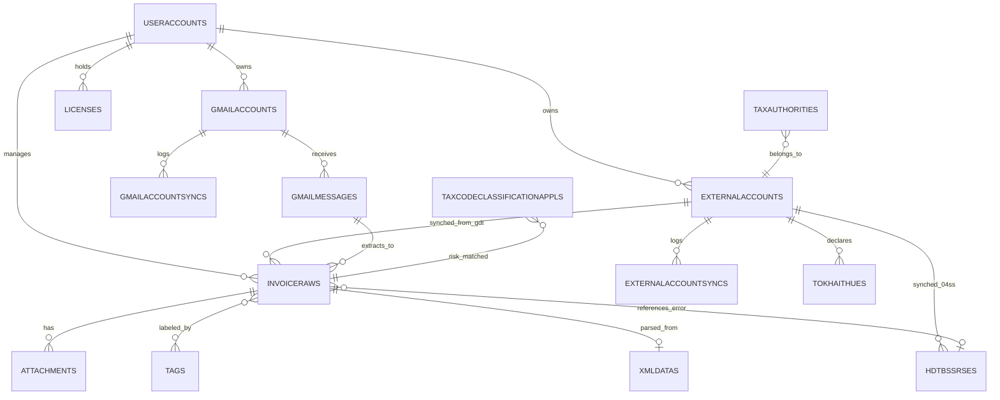

# DOC-11 — Mô hình Dữ liệu & Từ điển Cơ sở Dữ liệu mSMI

| Phiên bản | Ngày | Tác giả | Trạng thái |
|:---:|:---:|:---:|:---:|
| 2.0 | 2026-11-08 | BA / Solution Architect | Baseline Unified v2.0 |

> **Phân loại tài liệu:** Platform Data Model (Mô hình Dữ liệu Lõi)  
> **Căn cứ tài liệu gốc:** `mSMI - Tài liệu thiết kế CSDL.docx`, `SMI_Sơ đồ nghiệp vụ.json`, `[mSMI] Document API.docx`.

---

## 1. Giới thiệu & Phạm vi

Tài liệu này chuẩn hóa toàn bộ cấu trúc dữ liệu lưu trữ của hệ thống mSMI từ tài liệu thiết kế cơ sở dữ liệu gốc (`mSMI - Tài liệu thiết kế CSDL.docx`). Hệ thống sử dụng cơ sở dữ liệu tài liệu NoSQL (MongoDB) kết hợp lưu trữ tệp (File Storage) với cấu trúc phân tán theo multi-tenant (dựa trên `user` / `account` / `nbmst`).

### Quy ước Thiết kế & Khóa chính
- **Cơ sở dữ liệu:** MongoDB Collections.
- **Khóa chính:** `_id` (kiểu `ObjectId`).
- **Khóa logic duy nhất của Hóa đơn (`invoiceraws.key`):**
  $$\text{key} = \text{nbmst} + \text{"\_"} + \text{khhdon} + \text{"\_"} + \text{parseInt(shdon)} + \text{"\_"} + \text{parseInt(khmshdon)}$$
- **Bảo mật & Mã hóa:** Mật khẩu tài khoản CQT, API token, IMAP password và các tệp đính kèm nhạy cảm bắt buộc được mã hóa qua module mã hóa chuẩn (`algorithm`, `key`, `iv`) trước khi ghi xuống disk/DB.

---

## 2. Mô hình Khái niệm (Conceptual ERD)

---

## 3. Ma trận Phân nhóm Collections & Nguồn gốc Nghiệp vụ

| STT | Nhóm Dữ liệu | Tên Collection | Ý nghĩa Nghiệp vụ | Trace (UC / FR) |
|:---:|---|---|---|---|
| **1** | Hóa đơn & Đính kèm | `invoiceraws` | Lưu trữ dữ liệu tổng quan, chi tiết và trạng thái của hóa đơn | INVOIC-FR-001..007 RISK-FR-001..005 |
| **2** | Hóa đơn & Đính kèm | `attachments` | Quản lý tệp đính kèm hóa đơn (PDF, hợp đồng, biên bản) có mã hóa | INVOIC-FR-004 |
| **3** | Hóa đơn & Đính kèm | `tags` | Danh mục nhãn gán hóa đơn nội bộ của doanh nghiệp | INVOIC-FR-004 |
| **4** | Hóa đơn & Đính kèm | `xmldatas` | Lưu trữ toàn văn dữ liệu XML gốc của hóa đơn | INVOIC-FR-002 |
| **5** | Hóa đơn & Đính kèm | `hdtbssrses` | Lưu thông báo hóa đơn điện tử có sai sót Mẫu 04/SS-HĐĐT | TBSS-FR-001..005 |
| **6** | Hộp thư Hóa đơn | `gmailaccounts` | Cấu hình tài khoản email nhận hóa đơn (Gmail/IMAP) | MAILBX-FR-001 |
| **7** | Hộp thư Hóa đơn | `gmailaccountsyncs` | Lịch sử các phiên quét hòm thư email | MAILBX-FR-002, 005 |
| **8** | Hộp thư Hóa đơn | `gmailmessages` | Danh mục thư nhận được, tìm kiếm và cờ `hasMimeXml` | MAILBX-FR-002, 005 |
| **9** | Kết nối CQT | `externalaccounts` | Tài khoản đăng nhập Cổng Thuế (`hoadondientu.gdt.gov.vn`) | TAXACC-FR-001, 002 |
| **10** | Kết nối CQT | `externalaccountsyncs` | Lịch sử các phiên đồng bộ dữ liệu với Cổng Thuế | TAXACC-FR-004 |
| **11** | Báo cáo & Kê khai | `tokhaithues` | Snapshot và số liệu Tờ khai thuế GTGT Mẫu 01/GTGT | REPORT-FR-002, 003 |
| **12** | Báo cáo & Kê khai | `exportexcelconfigs` | Cấu hình mẫu bảng kê động xuất sang PM kế toán | REPORT-FR-004 |
| **13** | Rủi ro & Thuế | `taxcodeclassificationappls` | Danh mục 1.500 doanh nghiệp rủi ro cao về hóa đơn | RISK-FR-002 |
| **14** | Rủi ro & Thuế | `taxcodeclassifications` | Bảng màu và quy tắc định nghĩa trạng thái rủi ro MST | RISK-FR-001 |
| **15** | Rủi ro & Thuế | `taxcodeinfos` | Dữ liệu pháp lý của NNT từ hệ thống Thuế | RISK-FR-001 |
| **16** | Rủi ro & Thuế | `taxcodeinfousers` | Liên kết giữa MST và các tài khoản người dùng được phân quyền | TAXACC-FR-001 |
| **17** | Rủi ro & Thuế | `taxauthorities` | Danh mục Cơ quan thuế các cấp trên toàn quốc | TAXACC-FR-001 |
| **18** | Bản quyền & Khách | `licenses` | Bản quyền sử dụng theo số lượng hóa đơn và dung lượng | BRD-MODULE |
| **19** | Bản quyền & Khách | `packs` | Danh mục các gói dịch vụ phân phối (hóa đơn, dung lượng) | BRD-MODULE |
| **20** | Hệ thống | `useraccounts` | Tài khoản đăng nhập, cây đại lý và phân quyền quản trị | BRD-MODULE |
| **21** | Hệ thống | `apitokens` | Cấp phát token cho hệ thống kế toán bên ngoài gọi API | DOC-12-API |
| **22** | Hệ thống | `systemlogs` | Ghi vết lỗi và nhật ký hệ thống | DOC-06 |
| **23** | Hệ thống | `captchas` | Lưu trữ bộ đệm captcha giải mã Cổng Thuế | TAXACC-FR-001 |
| **24** | Hệ thống | `iamsessions` | Phiên làm việc người dùng | BRD-MODULE |
| **25** | Hệ thống | `momentamounts` | Cấu hình tham số thời gian kiểm tra trạng thái tự động | RISK-FR-001 |
| **26** | Danh mục | `productnames` | Danh mục tên hàng hóa tự động trích xuất từ hóa đơn | BRD-MODULE |
| **27** | Danh mục | `products` | Mã hàng, đơn vị tính và tài khoản định khoản kế toán | BRD-MODULE |
| **28** | Thuế TNCN | `chungtutncns` | Dữ liệu chứng từ khấu trừ thuế TNCN điện tử Mẫu 03/TNCN | TNCN-FR-001..005 |
| **29** | Thuế Điện tử | `declarations` | Tờ khai thuế điện tử cào từ Cổng eTax/DVC | MTAX-FR-002 |
| **30** | Thuế Điện tử | `payments` | Giấy nộp tiền NSNN qua ngân hàng liên kết Cổng Thuế | MTAX-FR-003 |
| **31** | Thuế Điện tử | `notices` | Thông báo bước 1 (tiếp nhận) & bước 2 (chấp nhận/từ chối) của CQT | MTAX-FR-004 |
| **32** | Tra cứu Công khai | `xmldatas` | Lưu trữ file XML và kết quả thẩm định chữ ký số công khai | KTHD-FR-002..003 |

---

## 4. Từ điển Dữ liệu Chi tiết (Data Dictionary)

### 4.1. Bảng `invoiceraws` (Hóa đơn thô & Tổng hợp)
Collection trung tâm của hệ thống, lưu trữ toàn bộ hóa đơn Mua vào và Bán ra.

| Tên trường | Kiểu dữ liệu | Bắt buộc | Mô tả & Ràng buộc |
|---|:---:|:---:|---|
| `_id` | ObjectId | Có | Định danh bản ghi duy nhất trong MongoDB. |
| `user` | ObjectId | Có | FK trỏ đến `useraccounts._id` (Người sở hữu hóa đơn). |
| `account` | ObjectId | Có | FK trỏ đến `externalaccounts._id` (Tài khoản CQT liên quan). |
| `type` | String | Có | Phân loại hóa đơn: `purchase` (mua vào thông thường), `purchase_sco` (mua vào máy tính tiền), `sold` (bán ra thông thường), `sold_sco` (bán ra máy tính tiền). |
| `key` | String | Có | Khóa duy nhất toàn hệ thống: `${nbmst}_${khhdon}_${parseInt(shdon)}_${parseInt(khmshdon)}`. Unique Index. |
| `keys` | Object | Có | Cặp trường lập index phục vụ tra cứu nhanh: `{ nbmst, nmmst, khhdon, shdon, khmshdon, tdlap }`. |
| `header` | Object | Có | Thông tin tổng quan lấy từ API list của CQT hoặc header email (MST bán, Tên bán, MST mua, Tên mua, Ngày lập, Ký hiệu, Số HĐ, Tổng tiền...). |
| `detail` | Object | Không | Dữ liệu chi tiết dòng hàng hóa dịch vụ lấy từ API chi tiết CQT hoặc parse XML. |
| `priority` | Number | Có | Độ ưu tiên cào detail: mặc định 0. Tăng lên khi người dùng bấm xem/lập báo cáo để ưu tiên xử lý trước. |
| `warning` | Object | Không | Kết quả phân tích rủi ro: `{ isWarning, codes: [], messages: [] }` từ `InvoiceUtil.getWarning`. |
| `assets` | Array | Không | Danh sách tài nguyên cần đồng bộ (ví dụ: `["detail"]`). |
| `tags` | Array[ObjectId] | Không | Danh sách `_id` các nhãn dán từ bảng `tags`. |
| `comment` | String | Không | Ghi chú nghiệp vụ nội bộ của kế toán. |
| `gmail` | Object | Không | Thông tin nguồn email nếu hóa đơn được bóc tách từ hộp thư: `{ messageId, attachments: [] }`. |
| `taxPeriod` | String | Không | Kỳ kê khai thuế được gán (ví dụ: `2026-Q3`, `2026-10`). |
| `isCancelDeclare`| Boolean | Không | Cờ đánh dấu hóa đơn bị hủy kê khai / hoãn kê khai sang kỳ sau. |
| `isHideWarning` | Boolean | Không | Cờ kế toán xác nhận ẩn cảnh báo đỏ đối với hóa đơn này. |
| `last_updated_date`| Date | Có | Thời điểm cập nhật dữ liệu gần nhất. |

**Chỉ mục (Indexes):**
- `idx_unique_key`: `{ key: 1 }` (Unique).
- `idx_for_stats`: Phục vụ truy vấn tổng hợp trên Dashboard.
- `idx_for_sort_report`: Phục vụ lọc và sắp xếp trên Bảng kê báo cáo thuế.

---

### 4.2. Bảng `externalaccounts` (Tài khoản Cổng Cơ quan Thuế)

| Tên trường | Kiểu dữ liệu | Bắt buộc | Mô tả & Ràng buộc |
|---|:---:|:---:|---|
| `_id` | ObjectId | Có | Định danh tài khoản. |
| `user` | ObjectId | Có | FK trỏ đến `useraccounts._id`. |
| `type` | String | Có | Cố định `hoadondientu-gov`. |
| `description` | String | Không | Tên đơn vị / Tên công ty đại diện. |
| `username` | String | Có | Mã số thuế đăng nhập Cổng HĐĐT. |
| `password` | String | Có | Mật khẩu tài khoản Thuế (bắt buộc mã hóa trước khi lưu). |
| `token` | String | Không | Token phiên làm việc hiện tại với CQT (mã hóa). |
| `profile` | Object | Không | Dữ liệu hồ sơ NNT trả về từ CQT (Tên, địa chỉ, cơ quan thuế quản lý). |
| `sync_invoices_sold` | Object | Có | Cấu hình tự động đồng bộ bán ra: `{ run, running, run_count, error_count, ran, done, last_sync }`. |
| `sync_invoices_purchase` | Object | Có | Cấu hình tự động đồng bộ mua vào: `{ run, running, run_count, error_count, ran, done, last_sync }`. |
| `config` | Object | Không | Cấu hình tham số mặc định cho Tờ khai 01/GTGT. |

---

### 4.3. Bảng `externalaccountsyncs` (Lịch sử Đồng bộ Thuế)

| Tên trường | Kiểu dữ liệu | Bắt buộc | Mô tả & Ràng buộc |
|---|:---:|:---:|---|
| `_id` | ObjectId | Có | Khóa chính. |
| `user` | ObjectId | Có | FK trỏ `useraccounts`. |
| `account` | ObjectId | Có | FK trỏ `externalaccounts`. |
| `type` | String | Có | `purchase`, `purchase_sco`, `sold`, `sold_sco`. |
| `status` | String | Có | Trạng thái phiên: `RUNNING`, `SUCCESS`, `ERROR`. |
| `ge` | Date | Có | Thời gian bắt đầu khoảng đồng bộ (`fromDate`). |
| `le` | Date | Có | Thời gian kết thúc khoảng đồng bộ (`toDate`). |
| `total` | Number | Có | Tổng số hóa đơn phát hiện trên Cổng Thuế trong khoảng `ge - le`. |
| `synced` | Number | Có | Số lượng hóa đơn đã đồng bộ thành công. |
| `created` | Number | Có | Số lượng hóa đơn mới được thêm vào mSMI. |
| `latency` | Number | Không | Độ trễ thời gian phản hồi từ CQT (mili-giây). |
| `created_date` | Date | Có | Thời điểm chạy phiên đồng bộ. |

---

### 4.4. Bảng `gmailaccounts` & `gmailmessages` (Hộp thư Email)
- **`gmailaccounts`**:
  - `user`: FK `useraccounts`.
  - `name`, `email`: Tên và địa chỉ email nhận hóa đơn.
  - `token`: Mã truy cập Google OAuth2 hoặc App Password (mã hóa).
  - `sync`: Trạng thái và lịch trình chạy nền (`run`, `running`, `run_count`, `error_count`, `ran`, `done`, `last_sync`).
- **`gmailmessages`**:
  - `user`, `account`: Định danh sở hữu.
  - `key`: Message-ID từ máy chủ thư.
  - `search_key`: Chuỗi được lập chỉ mục gồm Người gửi, Tiêu đề, Nội dung thư phục vụ tìm kiếm toàn văn.
  - `detail`: Toàn văn dữ liệu email và danh sách file đính kèm.
  - `hasMimeXml`: Cờ Boolean xác nhận thư có tệp đính kèm hóa đơn `.xml` hoặc `.zip`.

---

### 4.5. Bảng `hdtbssrses` (Thông báo Hóa đơn Sai sót 04/SS)

| Tên trường | Kiểu dữ liệu | Bắt buộc | Mô tả & Ràng buộc |
|---|:---:|:---:|---|
| `_id` | ObjectId | Có | Khóa chính. |
| `user` | ObjectId | Có | FK `useraccounts`. |
| `account` | ObjectId | Có | FK `externalaccounts`. |
| `type` | String | Có | `purchase`, `purchase_sco`, `sold`, `sold_sco`. |
| `idtbao` | String | Có | Mã định danh thông báo 04/SS từ Cơ quan thuế. |
| `hdon` | Object | Có | Thông tin hóa đơn sai sót: Mẫu số, Ký hiệu, Số HĐ liên quan. |
| `raw` | String | Có | Toàn văn thông điệp XML gốc của tờ Thông báo 04/SS. |
| `dlhdon` | Object | Có | Dữ liệu bóc tách chi tiết: Tính chất (1-Hủy, 2-Đ/C, 3-Thay thế, 4-Giải trình), Lý do sai sót. |
| `created_date` | Date | Có | Ngày thông báo được lưu vào hệ thống. |

---

### 4.6. Bảng `tokhaithues` (Tờ khai Thuế GTGT 01/GTGT)

| Tên trường | Kiểu dữ liệu | Bắt buộc | Mô tả & Ràng buộc |
|---|:---:|:---:|---|
| `_id` | ObjectId | Có | Khóa chính. |
| `user` | ObjectId | Có | FK `useraccounts`. |
| `account` | ObjectId | Có | FK `externalaccounts`. |
| `type` | String | Có | Cố định `'01'` (Tờ khai Thuế GTGT Mẫu 01/GTGT). |
| `period` | String | Có | Kỳ tính thuế (ví dụ: `2026-Q3`, `2026-10`). |
| `config` | Object | Không | Thông tin chung phần đầu tờ khai: Tên NNT, MST, ngành nghề, người ký. |
| `data` | Object | Có | JSON chứa giá trị toàn bộ các chỉ tiêu [21] đến [43]. |
| `invoiceIds` | Array[ObjectId] | Không | Danh sách `_id` các hóa đơn tham gia cấu thành số liệu tờ khai. |
| `description` | String | Không | Ghi chú tờ khai. |
| `created_date` | Date | Có | Thời điểm lập tờ khai. |

---

### 4.7. Bảng `taxcodeclassificationappls` (1.500 DN Rủi ro cao)

| Tên trường | Kiểu dữ liệu | Bắt buộc | Mô tả & Ràng buộc |
|---|:---:|:---:|---|
| `_id` | ObjectId | Có | Khóa chính. |
| `taxCode` | String | Có | Mã số thuế của doanh nghiệp thuộc danh sách rủi ro cao (Index). |
| `companyName` | String | Có | Tên pháp lý của doanh nghiệp vi phạm. |
| `legalNotice` | String | Có | Căn cứ pháp lý / Số hiệu công văn của Tổng cục Thuế (ví dụ: CV 1798/TCT-TTKT). |
| `appliedDate` | Date | Có | Ngày hiệu lực đưa vào diện cảnh báo. |
| `isActive` | Boolean | Có | Trạng thái kích hoạt cảnh báo (mặc định `true`). |

---

### 4.8. Bảng `tags`, `attachments`, `licenses`, `packs`, `useraccounts`
- **`tags`**: Lưu nhãn dán: `code`, `name`, `description`, `color` (mã màu HEX), `disabled`.
- **`attachments`**: Lưu file đính kèm: `by` (`invoiceraws._id`), `properties`, `description`, `algorithm`, `key`, `iv` (mã hóa AES/DES), `purpose`.
- **`licenses`**: Quản lý gói cước đơn vị: `user`, `invoice_quantity`, `month`, `grand_total`, `from_date`, `thru_date`.
- **`packs`**: Danh mục gói cước: `type` (`invoice` hoặc `capacity`), `amount`, `price`, `disabled`.
- **`useraccounts`**: Tài khoản người dùng: `parent`, `relatives` (cây đại lý), `type` (admin, đại lý, khách hàng), `phone`, `email`, `disabled`, `license`.

---

### 4.9. Bảng `chungtutncns` (Chứng từ Khấu trừ Thuế TNCN Điện tử — Mẫu 03/TNCN)

Lưu trữ tại cơ sở dữ liệu `mSMI` (Model: `backend/models/chung_tu_tncn.js`), đồng bộ qua cụm worker `service/chung-tu-tncn/`:

| Tên trường | Kiểu dữ liệu | Bắt buộc | Mô tả Nghiệp vụ & Ràng buộc |
|---|:---:|:---:|---|
| `_id` | ObjectId | Có | Khóa chính MongoDB. |
| `user` | ObjectId | Có | FK `useraccounts` — Định danh doanh nghiệp/tài khoản sở hữu. |
| `msttcpt` | String | Có | Mã số thuế của tổ chức chi trả thu nhập (Đơn vị phát hành chứng từ). |
| `tentcpt` | String | Có | Tên cơ quan, tổ chức chi trả thu nhập. |
| `khmshdon` | String | Có | Ký hiệu mẫu số chứng từ: Thường là `'03/TNCN'` theo NĐ 123. |
| `khhdon` | String | Có | Ký hiệu chứng từ (ví dụ: `24TAA`). |
| `shdon` | String | Có | Số chứng từ khấu trừ thuế TNCN (1 đến 8 số). |
| `key` | String | Có | Khóa logic chống trùng: `${msttcpt}_${khmshdon}_${khhdon}_${shdon}` (Unique Index). |
| `mst` | String | Không | Mã số thuế của cá nhân được khấu trừ thu nhập (nếu có). |
| `hoten` | String | Có | Họ và tên người nộp thuế cá nhân được chi trả. |
| `cmnd` | String | Không | Số CCCD / Hộ chiếu cá nhân nhận thu nhập. |
| `khoanthunhap` | String | Không | Khoản thu nhập (Tiền công, tiền thù lao, đầu tư vốn...). |
| `thoidiemchitra`| Date | Có | Thời điểm chi trả thu nhập. |
| `tongthunhap` | Number | Có | Tổng thu nhập chịu thuế phải khấu trừ (VNĐ). |
| `sothuedakhautru`| Number | Có | Số tiền thuế TNCN đã khấu trừ (VNĐ). |
| `sothueconlai` | Number | Không | Số thu nhập còn lại thực nhận. |
| `xml_path` | String | Không | Đường dẫn URI file XML chứng từ gốc lưu trên MinIO S3 (`tncn-bucket`). |
| `tthai` | Number | Có | Trạng thái chứng từ: `1` - Gốc, `2` - Thay thế, `3` - Hủy. |

---

### 4.10. Các Bảng Thuộc Cơ sở Dữ liệu Thuế Điện tử (`mtax`)

Lưu trữ tại database độc lập `mtax` (MongoDB), phục vụ phân hệ `mtax-api` và `mtax-fe`:

#### 1. Bảng `declarations` (Tờ khai Thuế Điện tử eTax / DVC)
* `_id`: ObjectId khóa chính.
* `taxCode`: Mã số thuế doanh nghiệp khai nộp.
* `portalSource`: Nguồn cổng cào (`ETAX` hoặc `DVC`).
* `formCode`: Ký hiệu mẫu tờ khai (ví dụ: `01/GTGT`, `01/MBAI`, `02/TNDN`, `BC26`).
* `title`: Tên tờ khai chuẩn hóa theo danh mục Tổng cục Thuế.
* `taxPeriod`: Kỳ tính thuế (ví dụ: `2026-Q3`, `2026-10`, `2026`).
* `submissionType`: `0` - Chính thức; `>0` - Bổ sung lần N.
* `submittedAt`: Thời điểm nộp hồ sơ lên cổng thuế.
* `transactionId`: Mã giao dịch định danh CQT cấp cho hồ sơ khai thuế.
* `status`: Trạng thái xử lý (`1` - Chờ tiếp nhận, `2` - Đã tiếp nhận, `3` - Đã chấp nhận, `4` - Không chấp nhận).
* `xmlFileUri`: URI tệp XML tờ khai lưu trên S3.

#### 2. Bảng `payments` (Giấy Nộp Tiền NSNN)
* `_id`: ObjectId khóa chính.
* `taxCode`: Mã số thuế doanh nghiệp nộp thuế.
* `paymentNo`: Số tham chiếu / Số giấy nộp tiền ngân sách.
* `paidDate`: Thời điểm trích nợ tài khoản nộp vào Kho bạc.
* `treasury`: Tên Kho bạc Nhà nước tiếp nhận khoản thu.
* `budgetSubItem`: Mã tiểu mục mục lục ngân sách nhà nước (ví dụ: `1701` - Thuế GTGT, `1052` - Thuế TNDN).
* `amount`: Số tiền nộp thực tế (VNĐ).
* `bankAccount`: Tài khoản trích nợ của doanh nghiệp tại ngân hàng thương mại.
* `status`: `success` (Nộp thuế thành công có chữ ký số xác nhận của ngân hàng & KBNN).

#### 3. Bảng `notices` (Thông báo của Cơ quan Thuế)
* `_id`: ObjectId khóa chính.
* `taxCode`: Mã số thuế doanh nghiệp.
* `declarationId`: FK liên kết với `declarations._id` (theo mã hồ sơ).
* `noticeType`: Phân loại thông báo (`step1` - Tiếp nhận trong 15 phút, `step2` - Chấp nhận/từ chối trong 1 ngày làm việc).
* `noticeNo`: Số hiệu văn bản thông báo của CQT.
* `issuedDate`: Ngày phát hành thông báo.
* `result`: `accepted` (Chấp nhận) hoặc `rejected` (Không chấp nhận).
* `reasons`: Lý do chi tiết từ CQT nếu hồ sơ bị từ chối tiếp nhận.

---

### 4.11. Bảng `xmldatas` & Cấu trúc Thẩm định Pháp lý (`XmlData`)

Lưu trữ các tệp XML hóa đơn được tải lên tại `kiemtrahoadon.vn` hoặc phân tích kiểm tra trong `invoic`:

* `_id`: ObjectId khóa chính.
* `raw`: Chuỗi nội dung XML nguyên bản.
* `inspected_data`: Dữ liệu bóc tách phục vụ render bản in HTML (Người bán, Người mua, Chi tiết hàng hóa, Thuế suất).
* `warning`: Đối tượng chứa toàn bộ các cờ thẩm định pháp lý:
  - `xmlnven`: Boolean — Tệp XML nguyên vẹn theo chuẩn XSD CQT.
  - `ignone_nbcks`: Boolean — Chữ ký số nguyên bản không bị can thiệp.
  - `nbcks`: Object — Trích xuất chứng thư số (`SigningBy`, `Issuer`).
  - `nkhdhle`: Boolean — Chứng thư số hợp lệ tại thời điểm ký.
  - `nkhdtnlap`: Boolean — Ngày ký nằm trong khoảng hiệu lực của CA.
  - `dcma`: Boolean — Đã được Cơ quan Thuế cấp mã.
  - `cqtcma`: String — Chuỗi mã CQT cấp.
  - `owner_match`: Boolean — MST và tên công ty khớp hoàn toàn với CSDL đăng ký thuế.

---

## 5. Kiến trúc Lưu trữ Lai (Hybrid Storage): MongoDB + MinIO S3

Theo quyết định kiến trúc (`ADR-003`), hệ thống mSMI phân tách triệt để 2 tầng lưu trữ:
1. **Tầng Metadata (MongoDB Atlas / Replica Set):**
   - Chỉ lưu các trường thông tin chỉ mục tìm kiếm, trạng thái, cờ cảnh báo rủi ro và quan hệ định danh.
   - Dung lượng mỗi bản ghi MongoDB luôn giữ ở mức gọn nhẹ (< 5 KB), giúp tốc độ phản hồi tìm kiếm và phân trang đạt < 300ms.
2. **Tầng Đối tượng Nhị phân (MinIO S3 Storage):**
   - Lưu trữ toàn bộ các tệp nhị phân có dung lượng lớn: Tệp XML hóa đơn gốc, Tệp PDF bản thể hiện, Tệp đính kèm (`attachments`), Tệp XML tờ khai thuế (`mtax`), Tệp chứng từ TNCN.
   - Phân vùng Bucket theo mốc thời gian:
     - `minio-default`: Bucket chứa dữ liệu lịch sử và các tệp đính kèm nghiệp vụ.
     - `minio-202610`: Bucket phân vùng theo kỳ vận hành mở rộng, đảm bảo khả năng co giãn (scale-out) dung lượng không giới hạn mà không gây nghẽn I/O trên cơ sở dữ liệu MongoDB.

