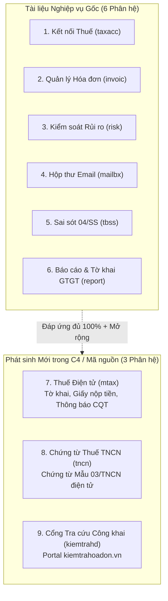

# Báo cáo Phân tích Chênh lệch (Gap Analysis): Tài liệu Nghiệp vụ Gốc vs Hiện trạng Kiến trúc C4

| Thông tin | Chi tiết |
|---|---|
| **Dự án** | mSMI — Nền tảng Quản lý & Đối soát Dữ liệu Hóa đơn, Thuế Doanh nghiệp |
| **Đối tượng đối chiếu** | 1. **Tài liệu Nghiệp vụ Gốc (AS-IS Requirements):** Bộ tài liệu BA thiết kế ban đầu (`sources-docs-standard-minipower`)<br>2. **Hiện trạng Kiến trúc C4 (AS-BUILT Reality):** Bộ tài liệu C4 phản ánh mã nguồn thực tế (`documents/c4` & `C4-docs-standard-minipower`) |
| **Mục đích** | Xác định và tổng hợp toàn bộ các điểm khác biệt (Gaps) về phạm vi nghiệp vụ, tính năng, kiến trúc và dữ liệu giữa thiết kế gốc và hệ thống thực tế đang vận hành |
| **Trạng thái** | Hoàn thành đối soát |

---

## 1. Bảng Tổng hợp Chênh lệch Cấp cao (Executive Comparison)

| Tiêu chí Đối chiếu | Tài liệu Nghiệp vụ Gốc (Docs Gốc) | Hiện trạng Kiến trúc C4 (Mã nguồn Thực tế) | Đánh giá Chênh lệch (Gap Analysis) |
|---|---|---|---|
| **Quy mô Phân hệ Nghiệp vụ** | **6 Phân hệ Cốt lõi** (Quản lý hóa đơn và tờ khai GTGT) | **9 Phân hệ Hoàn chỉnh** (Thêm mTax, TNCN, Cổng tra cứu mở) | **C4 mở rộng thêm 3 phân hệ độc lập lớn** chưa từng có trong tài liệu gốc. |
| **Phạm vi Nghiệp vụ Hóa đơn** | Thu thập, xem, tải, kiểm tra rủi ro, xử lý sai sót 04/SS và tính tờ khai 01/GTGT | Đầy đủ 100% nghiệp vụ gốc; bổ sung fallback render PDF nội bộ | **Khớp 100% nghiệp vụ cốt lõi**, không bị thiếu hụt tính năng. |
| **Đối tượng Người dùng (Actors)** | Kế toán viên, Kế toán trưởng, Quản trị viên doanh nghiệp | Bổ sung thêm: Người tra cứu công khai (Guest), Đại lý (Agent), Đội ngũ Vận hành (DevOps) | **C4 mở rộng thêm 3 nhóm tác nhân** phục vụ vận hành và dịch vụ công khai. |
| **Lưu trữ Tệp Nhị phân (XML/PDF)** | Lưu trực tiếp dạng file đính kèm / nhúng trong MongoDB | Tách sang cụm **MinIO Object Storage (S3)** phân vùng bucket | **C4 thay đổi kiến trúc lưu trữ** (MongoDB chỉ giữ metadata, file đẩy sang S3). |
| **Cơ chế Thu thập Dữ liệu (Crawl)** | Mô tả gọi API trực tiếp lên Cổng Thuế qua kết nối mạng chuẩn | Mạng lưới **Bot Desktop (SignalR) + Cụm Proxy Forwarder xoay IP** | **C4 phát sinh giải pháp kỹ thuật chuyên sâu** để vượt rate-limit và chống chặn IP từ CQT. |
| **Hàng đợi & Xử lý Bất đồng bộ** | Không đặc tả chi tiết hàng đợi | Phân tách **5 Hàng đợi Header RabbitMQ độc lập** (Manual, Retry, Daily, Month, Year) | **C4 bổ sung cơ chế phân luồng tải** tránh nghẽn luồng người dùng thao tác trực tiếp. |
| **Giám sát & Quản trị Hệ thống** | Không có tài liệu đặc tả | Ứng dụng **Ops Dashboard** + **Dashboard API (NestJS)** | **C4 phát sinh phân hệ nội bộ** giám sát tiến trình PM2, trạng thái queue và lỗi CQT. |

---

## 2. Chi tiết Chênh lệch về Phân hệ Nghiệp vụ (Business Module Gaps)



### 2.1. Đánh giá 6 Phân hệ Nghiệp vụ Cốt lõi có trong Tài liệu Gốc

| Mã Phân hệ | Tên Phân hệ | Yêu cầu trong Docs Gốc | Hiện trạng trong C4 / Code | Mức độ Đáp ứng | Ghi chú Khác biệt Kỹ thuật |
|:---:|---|---|---|:---:|---|
| `taxacc` | Kết nối CQT & Tài khoản thuế | Đăng nhập tài khoản CQT, hẹn giờ quét tự động, cào thủ công, giải Captcha, API cấu hình tài khoản | `auto_poller`, `auto_worker`, `externalaccountsyncs` | **Đạt 100%** | Bổ sung Bot Desktop và Proxy luân phiên IP chống chặn |
| `invoic` | Quản lý Hóa đơn Mua vào / Bán ra | Lọc đa tiêu chí, xem bản thể hiện HTML/PDF, xem XML gốc, tải ZIP hàng loạt, gán nhãn, gán kỳ kê khai, đính kèm chứng từ | `backend`, `frontend`, `invoiceraws` | **Đạt 100%** | Tách toàn bộ file sang MinIO S3; bổ sung Worker Chrome render fallback mẫu 1-6 khi CQT thiếu PDF |
| `risk` | Kiểm soát Rủi ro & Chữ ký số | Tra cứu trạng thái hoạt động MST, đối soát Blacklist 1.500 DN rủi ro cao, cảnh báo HĐ hủy/thay thế, kiểm tra chữ ký số | `service_tax_code_job`, `InvoiceUtil.getWarning`, `xml-service` | **Đạt 100%** | Kiểm tra chữ ký số nội tại trên XML gốc (`xmlVerified = true`); chưa gọi OCSP/CRL realtime |
| `mailbx` | Hộp thư Hóa đơn Tự động | Kết nối Gmail OAuth2 / App Password, IMAP SSL, quét nền tự động, giải nén ZIP bóc tách XML, chống trùng lặp HĐ | `service_email_invoice`, `gmailaccounts`, `emailaccounts` | **Đạt 100%** | Giữ nguyên 100% logic nghiệp vụ như thiết kế gốc |
| `tbss` | Thông báo Hóa đơn Sai sót 04/SS | Cào thông báo 04/SS từ CQT, xem bản thể hiện mẫu 04/SS, tải XML gốc, gắn cờ cảnh báo liên kết 2 chiều lên hóa đơn | `service_hdtbssres_*`, `consumer_invoice_raw_tbss.js` | **Đạt 100%** | Khẳng định mSMI chỉ cào và đối soát 04/SS; nghiệp vụ ký số phát hành mới thuộc phần mềm xuất HĐ |
| `report` | Báo cáo & Tờ khai 01/GTGT | Bảng kê gom nhóm thuế suất, tự tính Tờ khai 01/GTGT (chỉ tiêu [21]..[43]), xuất XML nộp HTKK, xuất Excel PMKT | `to_khai_thue.js`, `export_excel_config.js` | **Đạt 100%** | Tính chuẩn Tờ khai 01/GTGT; phụ lục giảm thuế GTGT 2% hỗ trợ qua trích xuất bảng kê Excel |

> **Kết luận 6 Phân hệ Gốc:** Mã nguồn thực tế được phản ánh trong C4 **đáp ứng trọn vẹn 100%** toàn bộ yêu cầu nghiệp vụ của tài liệu gốc, không bị khuyết thiếu nghiệp vụ cốt lõi nào.

---

### 2.2. Ba Phân hệ Mới Phát sinh trong C4 (Chưa có trong Tài liệu Gốc)

Dưới đây là 3 phân hệ hoàn chỉnh đã được xây dựng và vận hành trong mã nguồn, nhưng **hoàn toàn vắng bóng** trong tài liệu nghiệp vụ gốc:

#### 1. Phân hệ Thuế Điện tử (`mtax`)
* **Hiện trạng trong C4:**
  * Frontend: Ứng dụng React riêng biệt `mtax-fe/` (hoặc module `/to-khai-thue` trên Portal chính).
  * Backend: Microservice ASP.NET Core `mtax-api/`, RabbitMQ Exchange `mtax_crawl`, CSDL MongoDB `mtax`.
* **Nghiệp vụ thực tế:**
  * Kết nối tài khoản Cổng Thuế điện tử (`thuedientu.gdt.gov.vn`) và Cổng Dịch vụ công Quốc gia (`dichvucong.gov.vn`).
  * Tự động hoặc thủ công đồng bộ danh sách Tờ khai thuế (Môn bài, GTGT, TNDN...).
  * Đồng bộ và quản lý Giấy nộp tiền vào Ngân sách Nhà nước (kho bạc thụ hưởng, mã tiểu mục, số tiền).
  * Theo dõi Thông báo Cơ quan Thuế bước 1 (tiếp nhận) và bước 2 (chấp nhận / từ chối kèm lý do).
  * Tải tệp XML tờ khai nguyên bản (đơn lẻ hoặc đóng gói ZIP) mở qua iTaxViewer và xuất báo cáo danh sách Excel.
* **Tình trạng chênh lệch:** Docs gốc **hoàn toàn không có**.

#### 2. Phân hệ Quản lý Chứng từ Khấu trừ Thuế TNCN Điện tử (`tncn`)
* **Hiện trạng trong C4:**
  * Backend: Module worker `backend/service/chung-tu-tncn/`, model CSDL `backend/models/chung_tu_tncn.js`.
  * Luồng đồng bộ: Endpoint `GET /api/pitw`, queue `crawl-chung-tu-tncn-auto`, consumer `chungTuTncnHeader`.
* **Nghiệp vụ thực tế:**
  * Đồng bộ tự động theo lịch (chu kỳ chia chunk $\le$ 7 ngày) hoặc thủ công theo khoảng ngày các chứng từ khấu trừ thuế TNCN từ Cổng Thuế.
  * Bóc tách và lưu trữ chi tiết: Họ tên người lao động, MST cá nhân/CCCD, thu nhập chịu thuế, thu nhập tính thuế, số thuế TNCN đã khấu trừ, số tiền thực nhận.
  * Lưu trữ file XML gốc lên MinIO S3 (`xmlKey`) và hỗ trợ render bản in PDF chuẩn Mẫu 03/TNCN theo quy định Bộ Tài chính.
* **Tình trạng chênh lệch:** Docs gốc **hoàn toàn không có**.

#### 3. Phân hệ Cổng Tra cứu & Kiểm tra Hóa đơn Công khai (`kiemtrahd`)
* **Hiện trạng trong C4:**
  * Frontend: Ứng dụng React độc lập `kiemtrahoadon/` chạy trên tên miền công khai `kiemtrahoadon.vn`.
  * Backend: Route API công khai `routes/invoices/index.js` (`POST /upload_xml_data`, `GET /query/guest-invoices`), tích hợp dịch vụ giải Captcha CQT.
* **Nghiệp vụ thực tế:**
  * Cho phép khách vãng lai (không cần đăng nhập tài khoản) tra cứu trạng thái hóa đơn điện tử trực tiếp từ Cổng Thuế.
  * Cho phép người dùng tải lên tệp XML hóa đơn để hệ thống kiểm tra tính toàn vẹn, xác thực chữ ký số và đối chiếu mã CQT.
  * Xem trực quan bản thể hiện HTML/PDF và in phiếu kết quả thẩm định hóa đơn.
* **Tình trạng chênh lệch:** Docs gốc **hoàn toàn không có** (tài liệu gốc chỉ thiết kế cho người dùng đăng nhập nội bộ).

---

## 3. Chi tiết Chênh lệch về Kiến trúc & Hạ tầng Kỹ thuật

| Thành phần Kỹ thuật | Tài liệu Nghiệp vụ Gốc | Hiện trạng C4 / Mã nguồn Thực tế | Ý nghĩa & Lý do Thay đổi |
|---|---|---|---|
| **Lưu trữ File Nhị phân** | Lưu XML và PDF trực tiếp trong MongoDB (trường chuỗi / attachment) | Cụm lưu trữ đối tượng **MinIO S3** (`ADR-003`) với các phân vùng bucket (`minio-default`, `minio-202610`) | Tránh phình to dung lượng MongoDB, tối ưu tốc độ đọc metadata danh sách hóa đơn đạt < 300ms. |
| **Hạ tầng Crawl & Chống chặn CQT** | Mô tả gọi HTTP trực tiếp lên Cổng Tổng cục Thuế | Mạng lưới **Bot Desktop WinForms** nối qua **SignalR Hub**, kết hợp cụm **Proxy Forwarder** luân phiên đổi IP (`ADR-002`, `ADR-007`) | Xử lý triệt để bài toán Cổng Thuế chặn IP, giới hạn tần suất (rate-limit) và yêu cầu chữ ký môi trường desktop. |
| **Kiến trúc Hàng đợi (Message Queue)** | Không định nghĩa chi tiết | **RabbitMQ** phân tách riêng **5 Queue Header** độc lập (`ADR-004`): `manual`, `retry`, `daily`, `month`, `year` | Đảm bảo khi hệ thống chạy job quét định kỳ hàng nghìn doanh nghiệp, lệnh cào thủ công tức thì của người dùng không bị nghẽn. |
| **Cơ chế Fallback Render PDF** | Giả định luôn có file PDF tải từ Cổng Thuế | Backend tích hợp worker thread Chrome headless tự động render template **HTML Pug (Mẫu 1..6) sang PDF** | Khi Cổng Thuế chỉ lưu XML mà không có PDF, hệ thống vẫn xuất được đầy đủ bản in hóa đơn cho người dùng. |
| **Giám sát & Quản trị Vận hành** | Không đề cập | **Ops Dashboard** + **Dashboard API (NestJS)** giám sát 47 tiến trình PM2, trạng thái hàng đợi và tỷ lệ lỗi CQT | Phục vụ đội ngũ kỹ sư DevOps theo dõi sức khỏe hệ thống thời gian thực. |

---

## 4. Chi tiết Chênh lệch về Mô hình Dữ liệu (Data Model Gaps)

Tài liệu thiết kế CSDL gốc (`mSMI - Tài liệu thiết kế CSDL.docx`) chỉ đặc tả **14 collections** xoay quanh hóa đơn. Trong khi đó, C4 và CSDL thực tế vận hành có **32 collections**, xuất phát từ các bảng dữ liệu mới:

1. **Nhóm Dữ liệu Thuế Điện tử (`mtax`):**
   * `declarations`: Lưu thông tin tờ khai thuế đã nộp, mã giao dịch CQT, kỳ thuế, trạng thái phê duyệt.
   * `payments`: Lưu giấy nộp tiền vào ngân sách nhà nước, tài khoản kho bạc, mã tiểu mục nộp thuế.
   * `notices`: Lưu trữ các văn bản thông báo bước 1 và bước 2 của CQT.
2. **Nhóm Dữ liệu Chứng từ Thuế TNCN (`tncn`):**
   * `chungtutncns`: Lưu chứng từ khấu trừ thuế TNCN Mẫu 03/TNCN, bóc tách chỉ tiêu thu nhập và khóa MinIO S3 (`xmlKey`).
3. **Nhóm Danh mục Rủi ro & Doanh nghiệp:**
   * `taxcodeclassificationappls`: Lưu danh mục 1.500 doanh nghiệp rủi ro cao theo công văn CQT phục vụ đối soát tự động.
4. **Nhóm Vận hành Đồng bộ & Kênh Email:**
   * `externalaccountsyncs`, `gmailaccounts`, `emailaccounts`: Quản lý phiên làm việc đa kênh và lịch sử đồng bộ chi tiết.

---

## 5. Tổng kết & Đề xuất Thống nhất Tài liệu

```text
┌────────────────────────────────────────────────────────────────────────┐
│                        TỔNG KẾT GAP ANALYSIS                          │
├────────────────────────────────────────────────────────────────────────┤
│  1. Về Nghiệp vụ Cốt lõi:  ĐẠT 100% (Không khuyết thiếu tính năng)     │
│  2. Về Quy mô Phân hệ:     MỞ RỘNG TỪ 6 LÊN 9 PHÂN HỆ                  │
│  3. Về Hạ tầng Kỹ thuật:   NÂNG CẤP LÊN MINIO S3, PROXY, 5 QUEUES      │
└────────────────────────────────────────────────────────────────────────┘
```

* **Nguyên nhân chênh lệch:** Trong quá trình triển khai dự án, nhu cầu thực tế của khách hàng và những thay đổi từ phía Cơ quan Thuế đòi hỏi đội ngũ kỹ thuật phải mở rộng thêm nghiệp vụ Thuế điện tử (`mTax`), Chứng từ `TNCN`, Cổng tra cứu công khai, cũng như nâng cấp hạ tầng để vượt chặn kết nối. Tài liệu BA ban đầu đã không được cập nhật kịp thời theo mã nguồn.
* **Giải pháp chuẩn hóa:** Sử dụng bộ tài liệu **`DOC-v2.0`** làm bản Hợp nhất Tiêu chuẩn (Master Baseline):
  * Kế thừa nguyên vẹn toàn bộ 6 phân hệ nghiệp vụ cốt lõi từ tài liệu gốc.
  * Bổ sung đầy đủ hồ sơ chuẩn BA (`DOC-04`, `DOC-05`, `DOC-06`, `DOC-07`) cho 3 phân hệ phát sinh (`mtax`, `tncn`, `kiemtrahd`).
  * Cập nhật mô hình dữ liệu (`DOC-11`) và kiến trúc tích hợp (`DOC-12`) phản ánh đúng thực tế MinIO S3 và cụm microservices.

